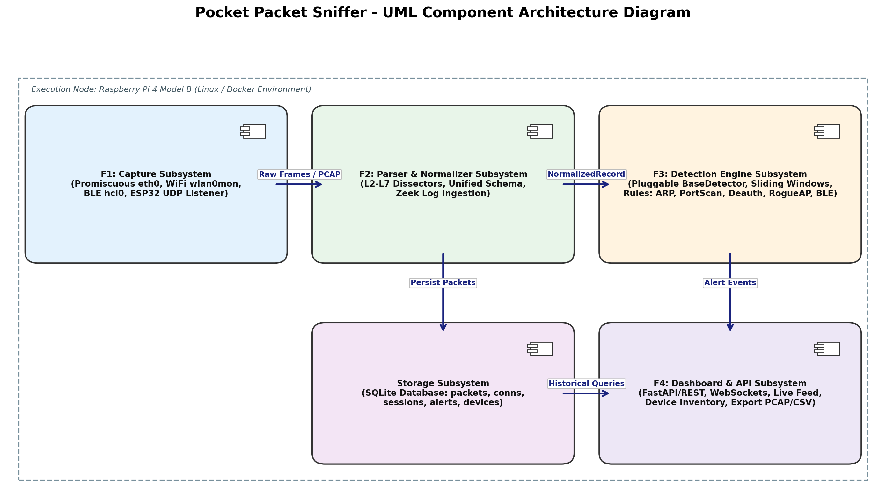
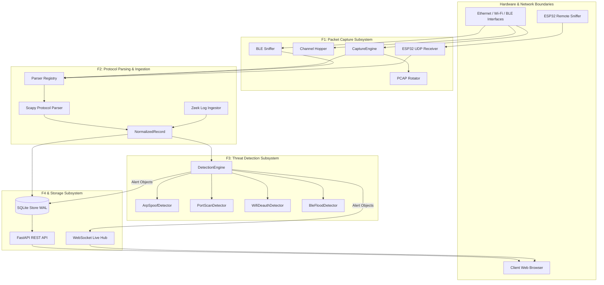

# Software Architecture Specification

**Project:** Pocket Packet Sniffer (PPS v1.0)  
**Standard:** IEEE 1016-2009 Recommended Practice for Software Design Descriptions (SDD)  
**Document ID:** PPS-ARCH-V1.0  
**Course:** Software Engineering (UE24CS341A) — PES University  

---

## 1. Introduction and Scope

### 1.1 Purpose
This document defines the software architecture for the Pocket Packet Sniffer (PPS). It details the architectural patterns, component breakdown, module responsibilities, requirements traceability, and security controls across all subsystems.

### 1.2 Scope
The Pocket Packet Sniffer is an edge-deployed network intrusion detection and packet analysis appliance running on a Raspberry Pi 4 Model B with optional ESP32 capture nodes. The architecture decomposes the system into four collaborating subsystems:
- **F1: Multi-Interface Packet Capture** (`src/capture`)
- **F2: Protocol Parsing & Zeek Integration** (`src/parser`)
- **F3: Threat & Anomaly Detection Engine** (`src/detection`)
- **F4: Live Dashboard, Device Inventory & Reporting** (`src/dashboard`, `src/storage`)

### 1.3 Architectural Goals and Constraints
1. **Low Latency:** End-to-end packet processing from physical capture to alert generation within 2.0 seconds (`NFR-PERF-01`, `NFR-PERF-02`).
2. **Resource Constraints:** Stable operation on a 4GB Raspberry Pi 4 Model B under sustained loads up to 5,000 packets/sec without unbounded memory consumption (`NFR-PERF-04`).
3. **Modularity and Extensibility:** Open/Closed Principle applied to threat detection rules via an abstract `BaseDetector` interface (`NFR-MAINT-01`).
4. **Privilege Boundaries:** Raw socket access isolated to capture threads; root privileges dropped for parsing and web presentation (`SEC-01`).

---

## 2. Architectural Patterns and Rationale

The system combines two well-established architectural patterns:

```
[Network Interfaces]
        │  (Raw Ethernet / 802.11 / BLE / UDP frames)
        ▼
┌──────────────────┐
│  F1: Capture     │  Filter 1: Promiscuous acquisition & PCAP rotation
└────────┬─────────┘
        │  (Raw Packet Buffers / PCAP files)
        ▼
┌──────────────────┐
│  F2: Parser      │  Filter 2: L2–L7 dissection & NormalizedRecord creation
└────────┬─────────┘
        │  (NormalizedRecord Objects)
        ▼
┌──────────────────┐
│  F3: Detection   │  Filter 3: Pluggable threat rule evaluation
└────────┬─────────┘
        │  (Alert Objects & Enriched Records)
        ▼
┌──────────────────┐
│  F4: Dashboard   │  Filter 4: SQLite WAL storage & WebSocket push
└──────────────────┘
```

### 2.1 Pipes-and-Filters Pattern (Core Data Flow)
- **Rationale:** Network traffic inherently flows as a continuous stream of discrete data packets. Decomposing processing into sequential, decoupled filters allows independent optimization, clear interface boundaries, and isolated unit testing.
- **Stage 1 (Filter):** Physical packet capture from network interfaces (`eth0`, `wlan0mon`, `hci0`, UDP port 5555).
- **Stage 2 (Filter):** Packet decoding, protocol normalization into `NormalizedRecord`, and Zeek connection log parsing.
- **Stage 3 (Filter):** Inspection through stateful threat detection rules producing structured `Alert` objects.
- **Stage 4 (Sink):** Persistence into SQLite with Write-Ahead Logging (WAL) and real-time broadcast over WebSockets.

### 2.2 Microkernel / Strategy Pattern (Threat Detection Subsystem)
- **Rationale:** Security threat signatures and anomaly thresholds evolve frequently. Hardcoding detection logic inside the engine creates tight coupling and high regression risk.
- **Implementation:** The `DetectionEngine` serves as the microkernel coordinating the stream. Individual threat detectors (`ArpSpoofDetector`, `PortScanDetector`, `WifiDeauthDetector`, `BleFloodDetector`) implement the abstract `BaseDetector` interface (Strategy pattern). Detectors are registered dynamically and run within defensive try-except sandboxes so a failure in one rule does not affect others.

---

## 3. Component Decomposition and UML Component Diagram

### 3.1 UML Component Architecture Diagram





### 3.2 Component Descriptions and Responsibilities

| Subsystem | Primary Modules | Key Responsibilities |
| :--- | :--- | :--- |
| **F1: Capture** | `src/capture/engine.py`<br>`src/capture/wireless.py`<br>`src/capture/ble_sniff.py`<br>`src/capture/esp32_ingest.py` | Binds to network interfaces, executes Wi-Fi 802.11 channel hopping, ingests raw BLE advertisement packets, listens on UDP port 5555 for ESP32 frames, and manages PCAP file size/time rotation. |
| **F2: Parser** | `src/parser/base.py`<br>`src/parser/protocol_parser.py`<br>`src/parser/registry.py`<br>`src/parser/zeek_ingest.py` | Dissects Ethernet, ARP, IPv4/v6, TCP, UDP, DNS, 802.11, and BLE layers using Scapy. Converts raw frames into typed `NormalizedRecord` objects. Follows Zeek log files (`conn.log`, `dns.log`) and normalizes connection events. |
| **F3: Threat Detection** | `src/detection/engine.py`<br>`src/detection/rules/base.py`<br>`src/detection/rules/*.py` | Validates input records against fuzzing/malformation. Dispatches records to registered detectors (`ArpSpoofDetector`, `PortScanDetector`, `WifiDeauthDetector`, `BleFloodDetector`). Maintains in-memory sliding windows with automatic time-based eviction. |
| **F4: Dashboard & Storage** | `src/dashboard/app.py`<br>`src/storage/sqlite_store.py` | Manages SQLite connection pooling in WAL mode. Exposes REST endpoints for packets, alerts, device inventory, and PCAP/CSV export. Runs an asynchronous WebSocket hub pushing real-time metrics and alerts to client browsers. |

---

## 4. Requirements Traceability

The following table traces functional and non-functional requirements from the SRS to architectural components:

| SRS Requirement | Description | Architectural Component | Implementation Verification |
| :--- | :--- | :--- | :--- |
| **REQ-F1-01** | Multi-Interface Capture (Ethernet, Wi-Fi, BLE, ESP32) | F1 Capture Subsystem (`src/capture`) | Verified via `tests/unit/test_capture.py` and hardware bench |
| **REQ-F1-03** | Automated PCAP File Rotation | `src/capture/engine.py` (`PcapRotator`) | Verified by size/time rotation test cases |
| **REQ-F2-01** | Protocol Dissection (L2–L7) | F2 Protocol Parser (`src/parser`) | Verified via `tests/unit/test_parser.py` (94% coverage) |
| **REQ-F2-03** | Zeek Connection Log Ingestion | `src/parser/zeek_ingest.py` | Verified via `tests/unit/test_zeek_integration.py` |
| **REQ-F3-01** | ARP Spoofing Detection | `src/detection/rules/arp_spoof.py` | Verified via `TC-F3-01` in `tests/test_detection/` |
| **REQ-F3-02** | Port Scan Sweep Detection | `src/detection/rules/port_scan.py` | Verified via `TC-F3-02` (SYN, FIN, NULL, XMAS sweeps) |
| **REQ-F3-03** | Wi-Fi Deauthentication Flood Detection | `src/detection/rules/wifi_deauth.py` | Verified via `TC-F3-04` (deauth frame bursts) |
| **REQ-F3-04** | BLE Advertisement Flood Detection | `src/detection/rules/ble_flood.py` | Verified via `TC-F3-07` (high-rate advertisement bursts) |
| **REQ-F4-01** | Web Dashboard Interface | `src/dashboard/app.py` | Verified via browser test and HTTP integration tests |
| **REQ-F4-02** | Live WebSocket Streaming | `src/dashboard/app.py` (`/ws/live`) | Verified via `docs/Latency_Report.md` (373 ms mean latency) |
| **REQ-F4-04** | Historical Query & Export (PCAP/CSV) | `src/dashboard/routes/export.py` | Verified via `TC-F4-04` export unit tests |
| **SEC-01** | Automated Static Code Analysis | Root `.bandit` & CI pipeline | Bandit verified 0 High, 0 Medium, 0 Low findings |
| **SEC-02** | Defensive Input Fuzzing Hardening | `DetectionEngine.validate_record` | Verified via `TC-SEC-02` (fuzzed/null inputs rejected safely) |
| **NFR-PERF-01** | Ingestion & Alert Latency <= 2.0s | Pipeline Queues + SQLite WAL | Latency measured at 373 ms (95th percentile 507 ms) |
| **NFR-PERF-04** | Memory Bounded on Raspberry Pi | Sliding-Window Time Eviction | Deques evict aged timestamps; memory remains constant |

---

## 5. Security Architecture

### 5.1 Principle of Least Privilege
The network sniffer requires elevated privileges (`CAP_NET_RAW` and `CAP_NET_ADMIN`) only during initialization to put network interfaces into promiscuous/monitor mode and bind raw sockets. In containerized deployments (Docker), the container is granted specific network capabilities without requiring full privileged host mode.

### 5.2 Input Validation and Fuzzing Defense (`SEC-02`)
Untrusted network packets can carry malformed headers, negative lengths, null bytes, or fuzzed IP addresses. The `DetectionEngine.validate_record` method acts as an input boundary validator:
- Rejects non-dict or non-`NormalizedRecord` objects.
- Enforces numeric timestamp validity ($t > 0$).
- Sanitizes transport port ranges ($0 \le port \le 65535$).
- Wraps every rule invocation in isolated `try-except` blocks so a malformed payload cannot abort execution.

### 5.3 Static Application Security Testing (SAST - `SEC-01`)
- **Bandit:** Configured via `.bandit` to scan `src/` on every commit. Enforces zero High and zero Medium severity vulnerabilities.
- **SonarQube:** Integrated into the CI workflow to track code smells, cyclomatic complexity, and security hotspots.
- **SQL Injection Prevention:** All database interactions in `src/storage/sqlite_store.py` use parameterized queries (`?` placeholders) to eliminate SQL injection vectors.

### 5.4 Data Integrity and Forensic Logging
Alert records persisted in SQLite are append-only. Each alert contains a unique UUID, ISO-8601 UTC timestamp, triggering rule name, calculated severity level, and a JSON-serialized evidence dictionary containing offending packet headers.

---

## 6. Deployment and Runtime Environment

### 6.1 Hardware Platform
- **Target Device:** Raspberry Pi 4 Model B (Quad-Core Cortex-A72 @ 1.5GHz, 4GB LPDDR4 SDRAM).
- **Network Adapters:**
  - Onboard Gigabit Ethernet (`eth0`) for management and local wired capture.
  - External USB Wi-Fi Adapter with monitor mode and packet injection support (`wlan0mon`).
  - Onboard Bluetooth 5.0 controller (`hci0`).
  - Remote ESP32 Wi-Fi sniffer node streaming raw frames over UDP port 5555.

### 6.2 Deployment Topology
The system runs either as a native `systemd` service (`pocket-sniffer.service`) or as a multi-stage Docker container (`docker-compose.yml`). The FastAPI web server is served via Uvicorn, binding to internal interfaces for dashboard access.
