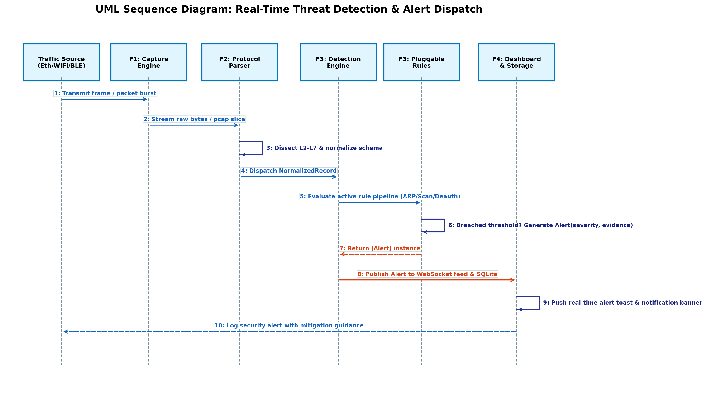
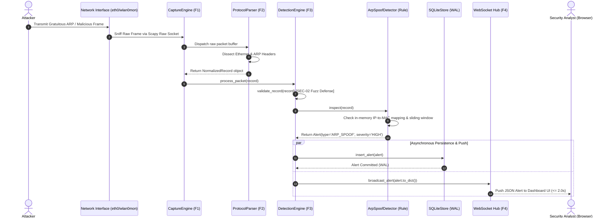
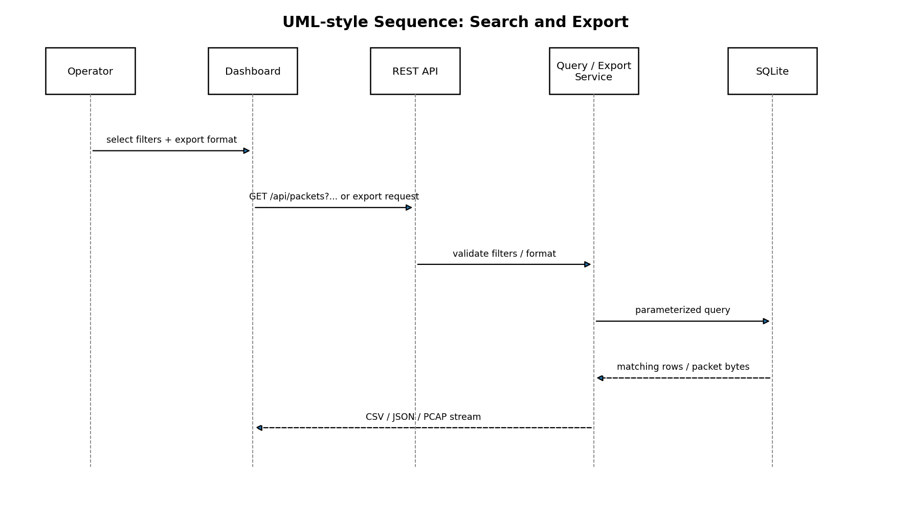

# Detailed Software Design Specification

**Project:** Pocket Packet Sniffer (PPS v1.0)  
**Standard:** IEEE 1016-2009 Software Design Description (SDD)  
**Document ID:** PPS-DESIGN-V1.0  
**Course:** Software Engineering (UE24CS341A) — PES University  

---

## 1. Design Overview

This document specifies the detailed design of the Pocket Packet Sniffer (PPS). It details module interactions via UML sequence diagrams, the REST and WebSocket API contracts, the relational SQLite database schema, detailed component interfaces, and runtime error handling policies.

---

## 2. UML Sequence Diagrams

### 2.1 Sequence Diagram 1: Real-Time Threat Detection & Alert Dispatch
This flow illustrates an incoming malicious network frame (e.g., an ARP spoofing attempt or TCP SYN sweep) being acquired by the capture engine, decoded by the parser, inspected by the detection engine, stored in SQLite, and pushed live to the web dashboard.





### 2.2 Sequence Diagram 2: Historical Search, Filtering & Session Export
This flow illustrates a security analyst querying past packets or alerts via the web dashboard and requesting an export in PCAP, CSV, or JSON format.



```mermaid
sequenceDiagram
    autonumber
    actor Analyst as Security Analyst
    participant Browser as Web Dashboard UI
    participant API as FastAPI Backend (/api/export)
    participant Storage as SQLiteStore
    participant Exporter as SessionExporter (PCAP/CSV)

    Analyst->>Browser: Select Filter (e.g., proto='TCP', src='192.168.1.50') & Format='PCAP'
    Browser->>API: GET /api/export?format=pcap&src_ip=192.168.1.50
    API->>API: Validate Query Parameters & Sanitization
    API->>Storage: query_packets(filter_params)
    Storage-->>API: Return matching packet records
    API->>Exporter: build_export_stream(records, format='pcap')
    Exporter-->>API: Stream bytes (StreamingResponse)
    API-->>Browser: HTTP 200 OK (Content-Disposition: attachment; filename="export.pcap")
    Browser-->>Analyst: File Download Complete
```

---

## 3. REST & WebSocket API Design

The dashboard backend (`src/dashboard/app.py`) is implemented using FastAPI and served via Uvicorn.

### 3.1 REST Endpoints

#### 3.1.1 Health & Appliance Status
- **Endpoint:** `GET /api/health`
- **Description:** Returns the operational status of all sniffer interfaces and hardware metrics.
- **Request Parameters:** None
- **Response Format (`application/json`):**
  ```json
  {
    "status": "HEALTHY",
    "cpu_usage_pct": 14.2,
    "memory_used_mb": 420.5,
    "memory_total_mb": 3840.0,
    "active_interfaces": ["eth0", "wlan0mon", "hci0"],
    "packet_rate_per_sec": 340,
    "uptime_seconds": 18450
  }
  ```

#### 3.1.2 Packet Telemetry
- **Endpoint:** `GET /api/packets`
- **Description:** Retrieves a paginated list of normalized network packets with optional multi-field filtering.
- **Query Parameters:**
  - `limit` (integer, default: 50, max: 500)
  - `offset` (integer, default: 0)
  - `interface` (string, optional: e.g., `"eth0"`)
  - `protocol` (string, optional: e.g., `"TCP"`, `"UDP"`, `"ARP"`)
  - `src_ip` (string, optional)
  - `dst_ip` (string, optional)
- **Response Format (`application/json`):**
  ```json
  {
    "total": 12840,
    "limit": 50,
    "offset": 0,
    "items": [
      {
        "id": 1042,
        "timestamp": 1730301045.281,
        "interface": "eth0",
        "link_type": "ETHERNET",
        "src_mac": "00:0c:29:3e:53:1a",
        "dst_mac": "e4:5f:01:2b:88:99",
        "src_ip": "192.168.1.100",
        "dst_ip": "192.168.1.1",
        "protocol": "TCP",
        "src_port": 54210,
        "dst_port": 443,
        "length": 66
      }
    ]
  }
  ```

#### 3.1.3 Security Alerts
- **Endpoint:** `GET /api/alerts`
- **Description:** Returns security alerts generated by the F3 detection engine.
- **Query Parameters:**
  - `severity` (string, optional: `"LOW"`, `"MEDIUM"`, `"HIGH"`, `"CRITICAL"`)
  - `threat_type` (string, optional: `"ARP_SPOOF"`, `"PORT_SCAN"`, `"DEAUTH_FLOOD"`, `"BLE_FLOOD"`)
  - `limit` (integer, default: 20)
- **Response Format (`application/json`):**
  ```json
  {
    "total": 3,
    "items": [
      {
        "alert_id": "7b83f3e1-5f21-4d32-9cb4-81a1a2b2c3d4",
        "timestamp": 1730301050.112,
        "threat_type": "ARP_SPOOF",
        "severity": "CRITICAL",
        "title": "ARP Spoofing Attack Detected",
        "description": "IP 192.168.1.1 claimed by MAC 00:0c:29:3e:53:1a conflicting with known MAC e4:5f:01:2b:88:99",
        "evidence": {
          "ip": "192.168.1.1",
          "conflicting_mac": "00:0c:29:3e:53:1a",
          "original_mac": "e4:5f:01:2b:88:99"
        },
        "mitigation": "Isolate port on managed switch; inspect offending host."
      }
    ]
  }
  ```

#### 3.1.4 Device Inventory
- **Endpoint:** `GET /api/devices`
- **Description:** Returns discovered active network hosts resolved via MAC OUI lookup.
- **Query Parameters:** `limit` (integer, default: 50), `offset` (integer, default: 0)
- **Response Format (`application/json`):**
  ```json
  {
    "total": 12,
    "items": [
      {
        "mac": "e4:5f:01:2b:88:99",
        "vendor": "Raspberry Pi Trading Ltd",
        "ip_address": "192.168.1.50",
        "hostname": "pocket-sniffer",
        "first_seen": 1730290000.0,
        "last_seen": 1730301055.4,
        "packet_count": 48210
      }
    ]
  }
  ```

#### 3.1.5 Session Export
- **Endpoint:** `GET /api/export`
- **Description:** Streams filtered network traffic in PCAP, CSV, or JSON format for external forensic analysis in Wireshark.
- **Query Parameters:**
  - `format` (string, required: `"pcap"`, `"csv"`, `"json"`)
  - `protocol`, `src_ip`, `dst_ip`, `start_time`, `end_time` (optional filters)
- **Response:** Binary stream with `Content-Type: application/vnd.tcpdump.pcap` or `text/csv`.

---

### 3.2 WebSocket Streaming API

- **Endpoint:** `ws://<host>:8000/ws/live`
- **Protocol:** WebSocket (JSON frames)
- **Broadcast Interval:** 500 ms periodic snapshot + immediate alert event push.
- **Message Payload Example:**
  ```json
  {
    "event_type": "METRICS_UPDATE",
    "timestamp": 1730301056.0,
    "packets_per_sec": 382,
    "bandwidth_kbps": 1420.4,
    "protocol_breakdown": {
      "TCP": 68.4,
      "UDP": 21.2,
      "ARP": 4.1,
      "DNS": 5.1,
      "OTHER": 1.2
    },
    "recent_alerts_count": 3
  }
  ```

---

## 4. Database Design (SQLite Relational Schema)

The SQLite database (`data/sniffer.db`) uses Write-Ahead Logging (`PRAGMA journal_mode=WAL`) and a busy timeout of 5000ms (`PRAGMA busy_timeout=5000`) to guarantee high-throughput concurrent writes from capture workers alongside concurrent reads from the web dashboard.

```
┌─────────────────────────────────┐       ┌─────────────────────────────────┐
│             packets             │       │           connections           │
├─────────────────────────────────┤       ├─────────────────────────────────┤
│ id: INTEGER (PK, AUTOINCREMENT) │       │ uid: TEXT (PK)                  │
│ timestamp: REAL                 │       │ start_time: REAL                │
│ interface: TEXT                 │       │ proto: TEXT                     │
│ link_type: TEXT                 │       │ orig_h: TEXT                    │
│ src_mac: TEXT                   │       │ orig_p: INTEGER                 │
│ dst_mac: TEXT                   │       │ resp_h: TEXT                    │
│ src_ip: TEXT                    │       │ resp_p: INTEGER                 │
│ dst_ip: TEXT                    │       │ duration: REAL                  │
│ protocol: TEXT                  │       │ orig_bytes: INTEGER             │
│ src_port: INTEGER               │       │ resp_bytes: INTEGER             │
│ dst_port: INTEGER               │       │ conn_state: TEXT                │
│ length: INTEGER                 │       └─────────────────────────────────┘
│ payload_snippet: BLOB           │
└─────────────────────────────────┘
                 │
                 ▼
┌─────────────────────────────────┐       ┌─────────────────────────────────┐
│             devices             │       │             alerts              │
├─────────────────────────────────┤       ├─────────────────────────────────┤
│ mac: TEXT (PK)                  │       │ alert_id: TEXT (PK)             │
│ vendor: TEXT                    │       │ timestamp: REAL                 │
│ ip_address: TEXT                │       │ threat_type: TEXT               │
│ hostname: TEXT                  │       │ severity: TEXT                  │
│ link_type: TEXT                 │       │ title: TEXT                     │
│ first_seen: REAL                │       │ description: TEXT               │
│ last_seen: REAL                 │       │ evidence_json: TEXT             │
│ packet_count: INTEGER           │       │ mitigation: TEXT                │
└─────────────────────────────────┘       └─────────────────────────────────┘
```

### 4.1 Indexing Strategy
To meet the latency requirement of <= 1000ms for queries (`NFR-PERF-03`):
- `CREATE INDEX idx_packets_ts ON packets(timestamp);`
- `CREATE INDEX idx_packets_ip ON packets(src_ip, dst_ip);`
- `CREATE INDEX idx_packets_proto ON packets(protocol);`
- `CREATE INDEX idx_alerts_ts ON alerts(timestamp);`
- `CREATE INDEX idx_alerts_sev ON alerts(severity);`
- `CREATE INDEX idx_devices_last_seen ON devices(last_seen);`

---

## 5. Detailed Subsystem Design

### 5.1 F2: Common Normalization Model (`NormalizedRecord`)
```python
@dataclass(slots=True)
class NormalizedRecord:
    timestamp: float
    interface: str
    link_type: str               # "ETHERNET", "WIFI", "BLE"
    src_mac: Optional[str] = None
    dst_mac: Optional[str] = None
    src_ip: Optional[str] = None
    dst_ip: Optional[str] = None
    protocol: Optional[str] = None # "TCP", "UDP", "ARP", "ICMP", "DNS"
    src_port: Optional[int] = None
    dst_port: Optional[int] = None
    length: int = 0
    payload: bytes = b""
    flags: Optional[str] = None
    dns_query: Optional[str] = None
```

### 5.2 F3: Threat Detection Subsystem Interface (`BaseDetector`)
All detection rules inherit from the abstract class `BaseDetector`:
```python
class BaseDetector(ABC):
    def __init__(self, name: str, config: Dict[str, Any]):
        self.name = name
        self.config = config
        self.enabled = config.get("enabled", True)

    @abstractmethod
    def inspect(self, record: NormalizedRecord) -> Optional[Alert]:
        """
        Inspects an incoming NormalizedRecord.
        Returns an Alert instance if a threat threshold is violated;
        otherwise returns None.
        """
        pass

    @abstractmethod
    def reset(self) -> None:
        """Flushes in-memory sliding window state."""
        pass
```

### 5.3 Memory Management via Sliding-Window Eviction
To satisfy `NFR-PERF-04` (bounded memory footprint on Raspberry Pi 4), stateful detectors (`PortScanDetector`, `WifiDeauthDetector`, `BleFloodDetector`) maintain history in double-ended queues (`collections.deque`):
- Each incoming event appends `(timestamp, target_detail)`.
- Before evaluating rule thresholds, entries with `timestamp < (current_time - window_size_seconds)` are popped from the left ($O(1)$ amortized eviction).
- This bounds the maximum memory allocated to each sliding window, preventing unbounded memory growth under sustained packet storms.

---

## 6. Error Handling and Fault Tolerance

| Fault Domain | Failure Scenario | Detection Mechanism | Recovery / Mitigation Policy |
| :--- | :--- | :--- | :--- |
| **Physical Capture** | Wi-Fi adapter disconnect or driver crash | Subprocess exit or `OSError` on raw socket | Channel hopper logs warning, attempts interface reset, falls back to wired Ethernet. |
| **Protocol Parsing** | Truncated, malformed, or fuzzed packet headers | Scapy dissection exception | Catch `Exception`, increment `malformed_packets_count`, discard frame; pipeline continues uninterrupted. |
| **Threat Detection** | Bug or divide-by-zero inside a specific detection rule | `try-except` inside `DetectionEngine.process_packet` | Catch exception, log rule-level error, continue evaluating remaining registered rules. |
| **Storage / SQLite** | High concurrent write load causing `sqlite3.OperationalError: database is locked` | SQLite lock detection | WAL mode enabled with 5000ms busy timeout; writes retry with exponential backoff. |
| **WebSockets** | Client browser disconnects ungracefully | `WebSocketDisconnect` exception | Server unregisters client connection cleanly without memory leakage or thread hanging. |
