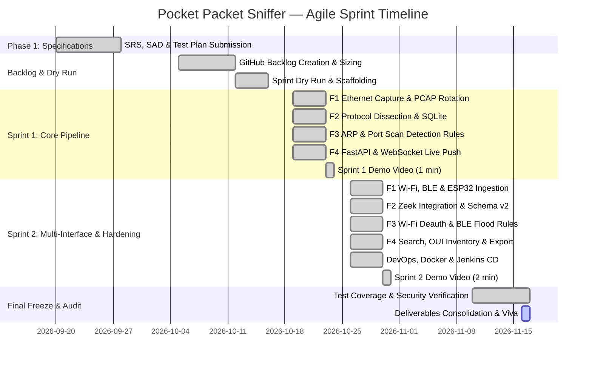

# Project Plan & Agile Management Specification

**Project:** Pocket Packet Sniffer (PPS v1.0)  
**Standard:** Agile Scrum Methodology & IEEE Project Management Guidelines  
**Document ID:** PPS-PLAN-V1.0  
**Course:** Software Engineering (UE24CS341A) — PES University  

---

## 1. Software Development Lifecycle (SDLC) Model

### 1.1 Methodology: Agile Scrum
The Pocket Packet Sniffer project was executed following the **Agile Scrum** methodology. Agile was selected over traditional sequential models (e.g., Waterfall) because building an edge security appliance involves rapid hardware-software integration, iterative threshold tuning, and continuous feedback.

The lifecycle was structured into:
- **Sprint Dry Run (Oct 12 – Oct 16, 2026):** Environment configuration, toolchain setup, repository scaffolding, and backlog calibration.
- **Sprint 1 (Oct 19 – Oct 23, 2026):** Foundation layer: Ethernet capture, basic packet parsing, core threat detection rules (ARP spoofing, port scanning), and initial dashboard layout.
- **Sprint 2 (Oct 26 – Oct 30, 2026):** Advanced capabilities: Wi-Fi monitor hopping, BLE sniffing, ESP32 ingestion, Zeek connection parsing, wireless threat detectors, Docker containerization, and final testing.
- **Freeze & Final Evaluation (Nov 2026):** Code freeze, comprehensive test and coverage verification, security audit, and final deliverable consolidation.

---

## 2. Team Organization and Subsystem Ownership

The project team consists of four undergraduate software engineers, each owning a distinct subsystem and cross-cutting project responsibility:

| Team Member | Subsystem Ownership | Key Responsibilities |
| :--- | :--- | :--- |
| **Ritu Ravish** *(PES1UG24CS928)* | **F3: Threat Detection Subsystem** & **Security Lead** | Engine architecture, rule interfaces (`BaseDetector`), ARP spoofing, port sweep, Wi-Fi deauth and BLE flood detection, Bandit SAST security gate, input validation (`SEC-02`), test suite (94% coverage), deliverables consolidation. |
| **Varshini G T** | **F1: Packet Capture Subsystem** & **DevOps Lead / Repo Owner** | Raw socket packet capture, 802.11 monitor hopping, BLE sniffer, ESP32 UDP receiver, PCAP file rotation, Docker containerization, Jenkins CD pipeline, PR reviews and merges. |
| **Tejaswini** | **F2: Protocol Parsing & Zeek Integration** & **Architecture Lead** | Scapy protocol decoders (Ethernet, ARP, IP, TCP, UDP, DNS, Wi-Fi, BLE), `NormalizedRecord` data model, Zeek log following (`zeek_ingest.py`), SQLite storage integration, SAD specification. |
| **Team Collaboration** | **F4: Live Monitoring, Inventory & Export** | FastAPI REST endpoints, WebSocket live hub, HTML5/Tailwind dashboard UI, device inventory with MAC OUI lookup, PCAP/CSV export functionality. |

---

## 3. Work Breakdown Structure (WBS) & Story Point Estimation

### 3.1 Estimation Technique
Effort estimation was performed using **Planning Poker** with modified Fibonacci story points:
- **1 Point:** Trivial task, config update, or unit test case addition (< 2 hours).
- **2 Points:** Straightforward module extension, schema adjustment, or bug fix (2–4 hours).
- **3 Points:** Standard feature implementation with unit test coverage (4–8 hours).
- **5 Points:** Complex component involving asynchronous I/O or multi-protocol parsing (1–2 days).
- **8 Points:** High-complexity architectural deliverable or multi-system integration (2–3 days).

### 3.2 Sprint 1 Work Breakdown (Oct 19 – Oct 23, 2026)

| Issue # | Subsystem | Backlog Item Title | Owner | Story Points |
| :--- | :--- | :--- | :--- | :--- |
| **#1** | F1 | Promiscuous Ethernet packet capture via Scapy | Varshini | 5 |
| **#2** | F1 | PCAP file rotation engine by size and time | Varshini | 3 |
| **#3** | F2 | Abstract `ProtocolParser` interface and registry | Tejaswini | 3 |
| **#4** | F2 | L2–L4 Scapy parser implementation | Tejaswini | 5 |
| **#5** | F2 | SQLite schema initialization and storage worker | Tejaswini | 5 |
| **#6** | F3 | `DetectionEngine` core and `BaseDetector` strategy | Ritu | 5 |
| **#7** | F3 | `ArpSpoofDetector` with IP-MAC conflict cache | Ritu | 5 |
| **#8** | F3 | `PortScanDetector` with sliding-window port count | Ritu | 5 |
| **#9** | F4 | FastAPI application skeleton and `/api/health` | Team | 3 |
| **#10** | F4 | WebSocket `/ws/live` streaming server | Team | 5 |
| **#11** | F4 | Responsive dashboard layout and live metric cards | Team | 5 |
| **#12** | DevOps | GitHub Actions CI workflow (lint + test runner) | Varshini | 3 |
| **#13** | Docs | 1-minute Sprint 1 working prototype demo video | Team | 2 |
| **Total** | | **Sprint 1 Delivered Velocity** | | **54 Points** |

### 3.3 Sprint 2 Work Breakdown (Oct 26 – Oct 30, 2026)

| Issue # | Subsystem | Backlog Item Title | Owner | Story Points |
| :--- | :--- | :--- | :--- | :--- |
| **#31** | F1 | Wi-Fi 802.11 monitor mode capture and channel hopper | Varshini | 8 |
| **#32** | F1 | Bluetooth Low Energy (BLE) advertisement sniffer | Varshini | 5 |
| **#33** | F1 | ESP32 remote sniffer UDP packet receiver (port 5555) | Varshini | 5 |
| **#34** | DevOps | Systemd boot service and Docker multi-stage container | Varshini | 5 |
| **#14** | F2 | Wi-Fi 802.11 management/control frame dissectors | Tejaswini | 5 |
| **#15** | F2 | BLE advertisement data decoder and normalization | Tejaswini | 3 |
| **#16** | F2 | Zeek log ingestion service (`conn.log`, `dns.log`) | Tejaswini | 8 |
| **#17** | F2 | SQLite WAL mode optimization and schema v2 migration | Tejaswini | 3 |
| **#18** | F3 | `WifiDeauthDetector` for 802.11 deauthentication floods | Ritu | 5 |
| **#19** | F3 | `BleFloodDetector` for advertisement packet storms | Ritu | 3 |
| **#20** | F3 | Fuzz hardening and schema validation (`SEC-02`) | Ritu | 3 |
| **#21** | F3 | Dynamic JSON-based threat threshold configuration | Ritu | 2 |
| **#23** | F3 | Bandit SAST integration and security policy | Ritu | 3 |
| **#24** | F3 | F3 test suite expansion (>85% branch coverage target) | Ritu | 3 |
| **#25** | F4 | Historical packet search with multi-parameter filters | Team | 5 |
| **#26** | F4 | Device inventory management with MAC OUI resolution | Team | 5 |
| **#27** | F4 | PCAP, CSV, and JSON session export API (`/api/export`) | Team | 5 |
| **#28** | F4 | Mobile-responsive dashboard navigation and alert feed | Team | 4 |
| **#30** | Docs | 2-minute Sprint 2 working product demo video | Team | 3 |
| **Total** | | **Sprint 2 Delivered Velocity** | | **63 Points** |

**Cumulative Team Velocity Across Project:** **117 Story Points**

---

## 4. Tooling and Development Infrastructure

| Tool / Service | Purpose in SDLC | Configuration / Details |
| :--- | :--- | :--- |
| **GitHub** | Git Version Control & Project Management | Central repository, feature branch workflow, GitHub Issues with story points. |
| **GitHub Actions** | Automated Continuous Integration (CI) | Workflow triggered on every Pull Request; runs Flake8, Bandit SAST, and Pytest. |
| **Bandit** | Static Application Security Testing (SAST) | Scans `src/` for security anti-patterns (`.bandit` config); requires 0 vulnerabilities. |
| **SonarQube** | Code Quality & Maintainability Gate | Analyzes code smells, cyclomatic complexity, test coverage via `sonar-project.properties`. |
| **Flake8** | PEP 8 Code Style Enforcement | Enforces clean Python styling and lint rules (`.flake8`). |
| **Pytest & Pytest-cov** | Automated Unit & Branch Testing | Validates functional logic; enforces >85% branch and line coverage targets. |
| **Docker & Docker Compose** | Reproducible Deployment | Multi-stage build for ARM64 and x86_64 environments (`Dockerfile`, `docker-compose.yml`). |

---

## 5. Risk Management and Mitigation Strategies

| Risk Description | Probability | Impact | Mitigation Strategy |
| :--- | :--- | :--- | :--- |
| **Raspberry Pi Memory Exhaustion:** High packet rates causing unbounded memory growth in threat detection state. | Medium | High | Implemented sliding-window time-based eviction using double-ended queues; bounded deque length caps RAM usage (`NFR-PERF-04`). |
| **Database Concurrency Lock:** High write frequency from capture workers blocking web dashboard reads. | Medium | High | Configured SQLite in Write-Ahead Logging (`WAL`) mode with a 5000ms busy timeout; writes never block reads. |
| **Raw Socket Privileges:** Running the entire sniffer process as root poses an appliance security vulnerability. | High | High | Minimal privilege architecture: capability permissions (`CAP_NET_RAW`, `CAP_NET_ADMIN`) granted to specific workers; UI runs unprivileged. |
| **Malformed Packet Ingestion:** Corrupted or intentionally fuzzed frames causing unhandled parsing exceptions. | High | Medium | Defensive programming with strict input validation in `validate_record` and per-rule exception sandboxing (`SEC-02`). |
| **Hardware Dependency Bottlenecks:** Delays in accessing physical Wi-Fi dongles or ESP32 nodes during early development. | Low | Medium | Implemented mock PCAP replay streams and synthetic packet generators, allowing full offline testing before hardware bench tests. |
