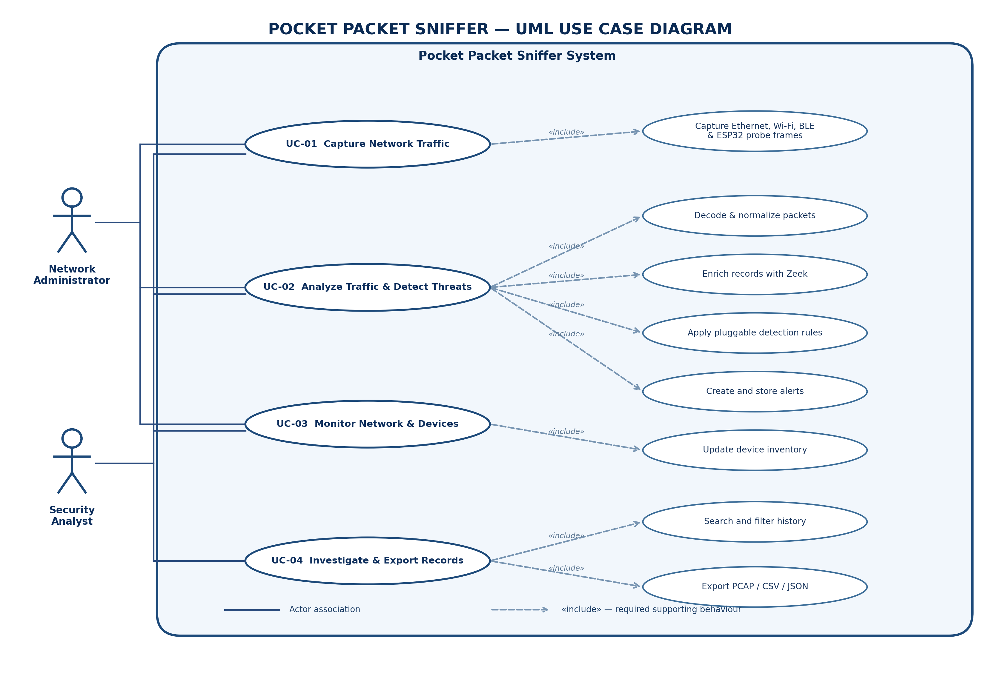
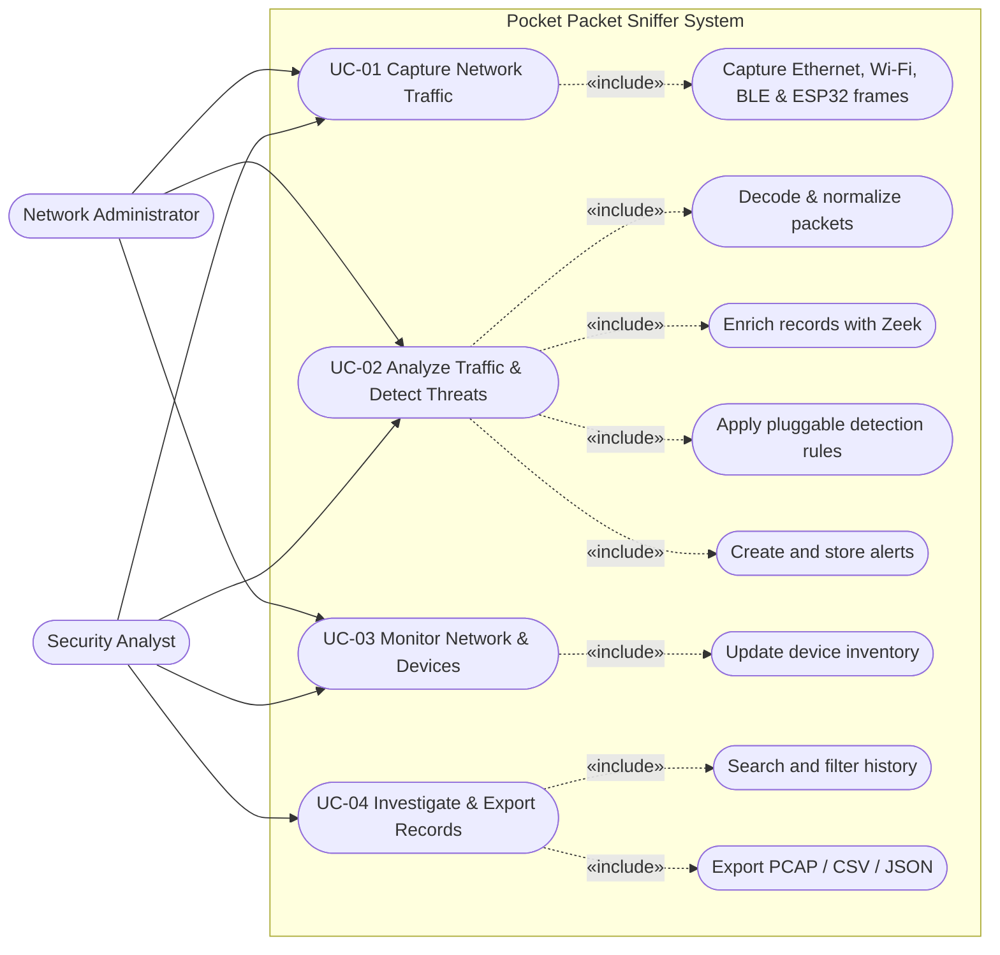

# Software Requirements Specification (SRS)
## Pocket Packet Sniffer
**Course:** Software Engineering (UE24CS341A)  
**Institution:** PES University, Department of Computer Science and Engineering  
**Version:** 1.0  
**Status:** Approved  
**Prepared by:** Ritu Ravish (Lead Consolidator), Vishal Prasath, Tejaswini R Pujar, Varshini A  
**Date:** October 2026  

---

## 1. Introduction

### 1.1 Purpose
This Software Requirements Specification (SRS) defines the complete software, hardware, and operational requirements for the **Pocket Packet Sniffer** (Version 1.0). The system is a compact, multi-interface network security appliance deployed on a Raspberry Pi with remote ESP32 sensor nodes. This document serves as the formal baseline for development, architecture design, and quality assurance verification across all four functional subsystems: Packet Capture (F1), Protocol Parsing & Zeek Integration (F2), Threat & Anomaly Detection (F3), and Live Monitoring & Reporting (F4).

### 1.2 Intended Audience
This document is prepared for:
* **Development Team:** To guide implementation across feature branches (`src/capture`, `src/parser`, `src/detection`, `src/dashboard`).
* **Quality Assurance Lead (Tejaswini R Pujar):** To validate requirement testability and construct the Software Test Plan (STP).
* **DevOps Lead (Vishal Prasath):** To configure CI/CD pipeline triggers, containerized builds, and deployment verification.
* **Scrum Master (Varshini A):** To verify requirements traceability across GitHub Project backlog issues and sprints.
* **Academic Evaluators & Instructors:** To review adherence to IEEE-830 standard requirements engineering principles.

### 1.3 Product Scope
The Pocket Packet Sniffer bridges the visibility gap between wired enterprise traffic and transient short-range wireless channels. The software captures packets across promiscuous Ethernet, monitor-mode WiFi (802.11 b/g/n), Bluetooth Low Energy (BLE), and remote ESP32 sniffer streams. It decodes multi-layer protocols, normalizes records into a single SQLite-backed data schema, ingests Zeek metadata, executes an extensible threat detection rule engine in real time, and serves an interactive web dashboard accessible via mobile and desktop browsers.

### 1.4 References
1. IEEE Std 830-1998: *Recommended Practice for Software Requirements Specifications*.
2. RFC 826: *An Ethernet Address Resolution Protocol (ARP)*.
3. RFC 791 / RFC 793 / RFC 768: *Internet Protocol (IPv4), Transmission Control Protocol (TCP), User Datagram Protocol (UDP)*.
4. IEEE 802.11-2020: *Wireless LAN Medium Access Control (MAC) and Physical Layer (PHY) Specifications*.
5. Bluetooth SIG: *Bluetooth Core Specification v4.2 / v5.0 (Low Energy)*.
6. Zeek Network Security Monitor Documentation (<https://docs.zeek.org>).
7. PES University: *Jackfruit Software Engineering Mini-Project Guidelines 2026*.

---

## 2. Overall Description

### 2.1 Product Perspective
The Pocket Packet Sniffer operates as an autonomous edge appliance. It acts as an embedded intrusion detection and packet analysis system running primarily on a Raspberry Pi 4 Model B running Linux (Raspberry Pi OS / Debian), augmented with ESP32 microcontrollers deployed as remote radio capture probes communicating over Wi-Fi/UDP.

```
       +-------------------------------------------------------+
       |                  Physical Network                     |
       |    [Ethernet LAN]      [802.11 WiFi]     [BLE Beacons]|
       +--------+--------------------+-------------------+-----+
                |                    |                   |
                v                    v                   v
       +-------------------------------------------------------+
       |   F1: Multi-Interface Capture (eth0, wlan0mon, hci0)  |
       |        + Remote ESP32 Sniffer Node Frame Ingestion    |
       +----------------------------+--------------------------+
                                    | Raw PCAP / Frame Streams
                                    v
       +-------------------------------------------------------+
       |   F2: Protocol Parsing, Normalization & Zeek Ingest   |
       |       Storage: SQLite (packets, conns, sessions)      |
       +-------------------+-----------------------------------+
                           | NormalizedRecord Stream
                           v
       +-------------------------------------------------------+
       |   F3: Threat & Anomaly Detection Engine (Rule-Based)  |
       |       Alert Pipeline (Severity, Evidence, Remediation)|
       +-------------------+-----------------------------------+
                           | Alert & Traffic Telemetry
                           v
       +-------------------------------------------------------+
       |   F4: Dashboard, REST/WebSocket API & Inventory       |
       |       (Live feeds, charts, PCAP/CSV/JSON export)      |
       +-------------------------------------------------------+
```

### 2.2 Product Functions
* **Promiscuous & Monitor Capture:** Raw packet ingestion across Ethernet (`eth0`), WiFi monitor mode (`wlan0mon`) with 2.4 GHz channel hopping, Bluetooth Low Energy (`hci0`), and ESP32 remote probes.
* **Protocol Decoding & Zeek Enriched Telemetry:** Multi-layer packet dissection (L2-L7) into a unified relational database and ingestion of Zeek connection logs.
* **Real-time Threat & Anomaly Detection:** Rule-based detection of ARP cache poisoning, TCP/UDP port scans, DNS anomalies, 802.11 Deauth floods, Rogue/Evil-Twin APs, and BLE advertisement floods.
* **Interactive Monitoring & Reporting:** Web-based GUI featuring real-time bandwidth metrics, protocol distributions, device inventory with MAC OUI fingerprinting, and session exports.

### 2.3 User Classes and Characteristics
* **Security Analyst / Pen-Tester:** Skilled user seeking anomalies, deauth attacks, rogue APs, and attack PCAP captures.
* **Network Administrator:** Monitors local subnet utilization, IP-MAC consistency, bandwidth hogs, and rogue wireless devices.
* **Academic Evaluator / Student:** Verifies software engineering rigor, test coverage, code architecture, and CI/CD automation.

### 2.4 Operating Environment
* **Hardware Appliance:** Raspberry Pi 4 Model B (4GB/8GB RAM), Quad-core ARM Cortex-A72 @ 1.5GHz.
* **Remote Probes:** NodeMCU ESP32-WROOM-32 microcontrollers configured with promiscuous sniffer firmware.
* **Operating System:** Linux (Debian 12 Bookworm / Raspberry Pi OS 64-bit).
* **Runtime Stack:** Python 3.11+, SQLite 3, Zeek 5.0+, Docker 24+, Systemd.
* **Client Browser:** Chromium, Mozilla Firefox, Safari (Mobile & Desktop).

### 2.5 Design and Implementation Constraints
* **Resource Bounds:** The entire pipeline must run smoothly within 4 GB RAM and moderate CPU limits of a Raspberry Pi 4 without packet drop during typical lab loads (up to 5,000 pkts/sec).
* **Linux Kernel Privileges:** Monitor mode and raw socket capture require Linux capabilities (`CAP_NET_RAW`, `CAP_NET_ADMIN`) or root privileges.
* **Modularity:** Modules must remain loosely coupled using clean interfaces and data contracts (`NormalizedRecord`, `Alert`).
* **Storage Constraint:** On-device SQLite database size must be bounded with automatic rotation to prevent SD card exhaustion.

### 2.6 Assumptions and Dependencies
* The host WiFi adapter supports monitor mode and packet injection (e.g., Atheros AR9271, RT3070, or onboard broadcom with nexmon).
* The Raspberry Pi has an active Bluetooth adapter (`hci0`) with bluez installed.
* Third-party tools (Zeek, Scapy, Bandit, SonarQube) remain compliant with open-source licensing.

---

## 3. External Interface Requirements

### 3.1 User Interfaces
* **Web UI Dashboard:** Responsive single-page web application served at `http://<pi-ip>:8000/`.
* **Live Feed Panel:** Table updating dynamically via WebSocket showing timestamp, interface, src/dst IP, protocol, length.
* **Alert Bell / Notification Bar:** Visual alert banner color-coded by severity (`CRITICAL`: Red, `HIGH`: Orange, `MEDIUM`: Yellow, `LOW`: Blue).
* **Device Inventory Table:** Lists detected devices, vendor (via MAC OUI lookup), first/last seen timestamps, and active channel/RSSI.
* **Export Controls:** Modal dialog permitting download of filtered sessions in PCAP, CSV, and JSON formats.

### 3.2 Software Interfaces
* **F1 -> F2:** Raw frame byte arrays and PCAP file handles passed from Capture engine to Parser workers.
* **F2 -> F3:** Ingestion of strongly-typed `NormalizedRecord` objects containing dissected network attributes.
* **F3 -> F4:** Publication of structured `Alert` objects dispatched to database and real-time WebSocket feeds.
* **F2/F4 -> SQLite Database:** Structured schema (`packets`, `connections`, `devices`, `alerts`) stored locally in SQLite.

### 3.3 Communication Interfaces
* **Internal Inter-Module IPC:** Python asyncio event loops, in-memory queues (`asyncio.Queue`), and SQLite WAL mode.
* **Client-Server Communication:** HTTP/1.1 REST endpoints and bidirectional WebSockets (`ws://<pi-ip>:8000/ws/live`).
* **Remote Probe Ingestion:** UDP socket listening on port `5555` ingesting ESP32 binary payload frames.

### 3.4 Hardware Interfaces
* **Ethernet PHY (`eth0`):** Promiscuous mode raw socket binding.
* **Wireless NIC (`wlan0` / `wlan1`):** `nl80211` driver interface managed via `iw` / `airmon-ng`.
* **Bluetooth HCI (`hci0`):** Linux BlueZ socket interface for BLE advertisement scanning.

---

## 4. Analysis Models

### 4.1 Use Case Model (System-Wide)

#### 4.1.1 Use Case Diagram
The following UML Use Case model illustrates the primary actors interacting with the Pocket Packet Sniffer system boundary, along with the core and included subordinate use cases:





#### 4.1.2 Actor Descriptions
* **Network Administrator:** Responsible for monitoring local subnet performance, managing capture interfaces, verifying device inventory, and assessing bandwidth distribution across network segments.
* **Security Analyst:** Focuses on detecting active network anomalies (ARP cache poisoning, port scans, wireless deauthentication floods, rogue APs, BLE floods), reviewing structured forensic evidence, and exporting session captures for offline incident response.

#### 4.1.3 Primary Use Case Specifications
* **UC-01: Capture Network Traffic**
  * **Primary Actor:** Network Administrator / Security Analyst
  * **Preconditions:** Network interfaces (`eth0`, `wlan0mon`, `hci0`) or remote ESP32 probes are accessible with appropriate Linux capabilities (`CAP_NET_RAW`, `CAP_NET_ADMIN`).
  * **Trigger:** Operator activates packet capture session via command line or dashboard control.
  * **Main Success Scenario:**
    1. System initializes raw sockets on designated interfaces.
    2. Background channel hopper rotates wireless channels 1–13 at 250ms intervals.
    3. Captured frames are streamed to PCAP session files and the protocol parser queue (`«include» SUB-01`).
    4. PCAP files are automatically rotated upon reaching 50MB or 15 minutes.
  * **Postconditions:** Raw packet buffers are continuously supplied to the parsing pipeline without frame corruption.

* **UC-02: Analyze Traffic & Detect Threats**
  * **Primary Actor:** Security Analyst / Network Administrator
  * **Preconditions:** Raw frame stream is actively delivered from F1 capture modules.
  * **Trigger:** Arrival of incoming network packets at the parsing queue.
  * **Main Success Scenario:**
    1. Protocol parser decodes L2–L7 headers (`«include» SUB-02`).
    2. Extracted network metadata is enriched with Zeek telemetry (`«include» SUB-03`).
    3. `NormalizedRecord` objects are dispatched through registered `BaseDetector` rules in `DetectionEngine` (`«include» SUB-04`).
    4. Upon rule threshold violation, a standardized `Alert` object is generated with forensic evidence and remediation guidance (`«include» SUB-05`).
    5. Alerts are persisted to SQLite and broadcast via WebSocket to active monitoring clients.
  * **Postconditions:** Alerts are indexed and rendered in the dashboard alert banner with sub-second latency.

* **UC-03: Monitor Network & Devices**
  * **Primary Actor:** Network Administrator / Security Analyst
  * **Preconditions:** Dashboard backend service is running and accessible on port 8000.
  * **Trigger:** Client opens web dashboard at `http://<pi-ip>:8000/`.
  * **Main Success Scenario:**
    1. Backend establishes WebSocket connection (`/ws/live`) and transmits initial telemetry state.
    2. Incoming packets update live throughput metrics and protocol distribution charts in real time.
    3. Device discovery engine inspects MAC addresses, performs IEEE OUI vendor resolution, and updates the device inventory table (`«include» SUB-06`).
  * **Postconditions:** Live dashboard displays current packet stream, device inventory, and active alerts.

* **UC-04: Investigate & Export Records**
  * **Primary Actor:** Security Analyst
  * **Preconditions:** SQLite historical packet and alert tables contain stored session data.
  * **Trigger:** Analyst applies query filters or requests forensic export.
  * **Main Success Scenario:**
    1. Analyst filters historical traffic by interface, protocol, IP, or MAC substring (`«include» SUB-07`).
    2. Backend queries SQLite indexed tables and returns matching paginated records within 500ms.
    3. Analyst initiates export in PCAP, CSV, or JSON format (`«include» SUB-08`).
    4. System packages records and delivers downloadable file stream with valid MIME headers.
  * **Postconditions:** Forensic export file is saved locally by the analyst for offline verification.

---

## 5. System Features

### 5.1 System Feature 1: Multi-Interface Packet Capture (Owner: Vishal Prasath)
#### 5.1.1 Description and Priority
* **Description:** Manages simultaneous packet capture across Ethernet in promiscuous mode, WiFi in monitor mode with 2.4 GHz channel hopping, BLE advertisements, and remote ESP32 sniffer probe streams, supporting session recording and PCAP rotation.
* **Priority:** High.

#### 5.1.2 Stimulus/Response Sequences
1. **Stimulus:** Operator starts an Ethernet capture session on interface `eth0`.
   * **Response:** System puts `eth0` in promiscuous mode, opens a raw socket, and streams captured frames to the parser.
2. **Stimulus:** WiFi monitor mode is initialized.
   * **Response:** System creates virtual monitor interface `wlan0mon` and initiates background channel hopping across channels 1 to 13 every 250ms.
3. **Stimulus:** A remote ESP32 sniffer transmits UDP packets to port 5555.
   * **Response:** Ingestion worker receives UDP datagrams, extracts payload headers, and feeds them into the unified capture buffer.

#### 5.1.3 Functional Requirements
* **REQ-F1-01 (Promiscuous Ethernet Capture):** The system shall capture all Ethernet frames on designated interfaces (`eth0`) regardless of destination MAC address, sustaining sustained ingestion rates of at least 1,000 packets per second with packet loss $< 0.1\%$.
* **REQ-F1-02 (WiFi Monitor Mode & Channel Hopping):** The system shall put supported wireless adapters into 802.11 monitor mode and hop across 2.4 GHz channels 1–13 at a configurable frequency of $250\text{ ms} \pm 25\text{ ms}$ per channel.
* **REQ-F1-03 (Bluetooth Low Energy Capture):** The system shall capture Bluetooth Low Energy advertisement frames (`ADV_IND`, `ADV_NONCONN_IND`) using BlueZ HCI interfaces, decoding header metadata within $\le 50\text{ ms}$ of arrival.
* **REQ-F1-04 (Remote ESP32 Ingestion):** The system shall listen on UDP port 5555 to ingest raw wireless frames forwarded by external ESP32 sniffer probes at rates up to 500 packets per second without buffer overflow.
* **REQ-F1-05 (PCAP Session Management & Rotation):** The system shall save captured traffic into standard PCAP format files with automatic session rotation triggering within 1 second of reaching a file size limit of $50\text{ MB} \pm 1\text{ MB}$ or a time limit of $15\text{ minutes} \pm 5\text{ seconds}$.

---

### 5.2 System Feature 2: Protocol Parsing and Zeek Integration (Owner: Tejaswini R Pujar)
#### 5.2.1 Description and Priority
* **Description:** Decodes raw packets across Layer 2 through Layer 7, normalizes multi-interface data into a unified packet schema, ingests Zeek metadata logs, and manages persistence in SQLite.
* **Priority:** High.

#### 5.2.2 Stimulus/Response Sequences
1. **Stimulus:** Raw Ethernet frame arrives from F1.
   * **Response:** Parser decodes Ethernet header, IP header, and transport layer (TCP/UDP/ICMP), emitting a `NormalizedRecord` in $\le 1.0\text{ ms}$.
2. **Stimulus:** Zeek log daemon produces a `conn.log` entry.
   * **Response:** Zeek ingestion worker parses JSON/TSV connection record, enriching the corresponding connection table in SQLite within 100ms.

#### 5.2.3 Functional Requirements
* **REQ-F2-01 (Multi-Layer Protocol Decoding):** The system shall decode Link, Network, Transport, and Application protocols including Ethernet, 802.11, ARP, IPv4, TCP, UDP, ICMP, and DNS with per-packet parsing latency $\le 1.0\text{ ms}$.
* **REQ-F2-02 (Unified Packet Schema Normalization):** The system shall map disparate frame types (Ethernet, WiFi, BLE) into a unified `NormalizedRecord` data model with 100% field type validation and zero schema translation exceptions.
* **REQ-F2-03 (Zeek Telemetry Integration):** The system shall run Zeek against live and recorded traffic and ingest generated Zeek logs (`conn.log`, `dns.log`) into the metadata store at processing rates $\ge 500\text{ lines/sec}$.
* **REQ-F2-04 (SQLite Storage Layer):** The system shall persist parsed packets, active connections, and session metadata into SQLite with indexed columns for IP, MAC, and timestamp, executing batch writes of up to 500 records in $\le 50\text{ ms}$ in WAL mode.
* **REQ-F2-05 (Pluggable Parser Architecture):** The system shall provide an abstract protocol parser interface allowing new protocol dissectors to be added and registered at runtime without modifying existing parser pipelines.

---

### 5.3 System Feature 3: Threat and Anomaly Detection with Alerting (Owner: Ritu Ravish)
#### 5.3.1 Description and Priority
* **Description:** An extensible, pluggable rule-based detection engine that continuously inspects the normalized packet stream across Ethernet, WiFi, and Bluetooth Low Energy interfaces to identify network cyberattacks, protocol anomalies, and rogue entities in real time.
* **Priority:** High.

#### 5.3.2 Stimulus/Response Sequences
1. **Stimulus:** F2 Parser streams a normalized ARP reply where the claimed IP is bound to a new, conflicting MAC address.
   * **Response:** Detection Engine flags an IP-MAC conflict, generates a `CRITICAL` severity `Alert` object with offending MAC addresses and timestamps, and emits it to the alert dispatch pipeline in $\le 1.0\text{ second}$.
2. **Stimulus:** A remote host sends SYN packets across 15 distinct destination ports within a 5-second sliding window.
   * **Response:** Detection Engine flags a horizontal/vertical port scan, generates a `HIGH` severity `Alert` containing the attacker IP, scanned port range, and packet counts.
3. **Stimulus:** A WiFi client receives bursts of 802.11 Deauthentication frames (subtype 0x000C) exceeding 10 frames within a 2.0-second window.
   * **Response:** Detection Engine flags a WiFi Deauth Flood attack, generates a `HIGH` severity `Alert` detailing targeted BSSID, client MAC, frame count, and PMF mitigation advice.
4. **Stimulus:** An unrecognized BLE peripheral transmits excessive advertisement packets (`ADV_IND`) exceeding 20 packets/s or random MAC churning ($> 10$ distinct MACs in 2.0s).
   * **Response:** Detection Engine flags a BLE Advertisement Flood / MAC Churning DoS, generates a `MEDIUM` severity `Alert` with advertiser MAC, rate metrics, and burst volume.

#### 5.3.3 Functional Requirements
* **REQ-F3-01 (ARP Spoofing / Cache Poisoning Detection):** The system shall maintain a dynamic IP-to-MAC baseline table and detect when an incoming ARP packet attempts to associate an existing IP with an unauthorized or conflicting MAC address, generating a `CRITICAL` alert within $\le 1.0\text{ second}$.
* **REQ-F3-02 (ARP Reply Flood Detection):** The system shall monitor the rate of unsolicited/gratuitous ARP replies per MAC address and generate a `HIGH` severity alert if the count exceeds configurable threshold $N$ within sliding window $T$ seconds (default: 5 replies in 3.0s) with automatic sliding-window time eviction.
* **REQ-F3-03 (TCP/UDP Port Scan Detection):** The system shall track connection attempts from source IP addresses across multiple destination ports within a configurable sliding window and trigger a `HIGH` severity alert upon detecting horizontal sweeps or vertical port scans (default: $\ge 15$ distinct ports in 5.0s).
* **REQ-F3-04 (DNS Anomaly & Tunneling Detection):** The system shall provide rule hooks to analyze DNS query frequency, domain label length, entropy ($> 3.8\text{ bits/char}$), and NXDOMAIN error ratios to detect DNS tunneling and high-volume reconnaissance (status: deferred to hardware release phase; documented in `docs/Deviations.md`).
* **REQ-F3-05 (WiFi 802.11 Deauthentication Flood Detection):** The system shall monitor 802.11 management frames (subtypes 0x000C Deauth and 0x000A Disassoc) and trigger a `HIGH` severity alert if the frame rate directed at or broadcast by an AP exceeds the configurable flood threshold (default: $\ge 10$ frames in 2.0s).
* **REQ-F3-06 (Rogue and Evil-Twin AP Detection):** The system shall inspect beacon and probe response frames to detect duplicate SSIDs operating with unexpected BSSIDs, differing channel configurations, or degraded encryption suites (WPA2/WPA3 to OPEN), emitting alerts within $\le 2.0\text{ seconds}$ with storm deduplication.
* **REQ-F3-07 (BLE Advertisement Flood & Spoofing Detection):** The system shall inspect Bluetooth Low Energy advertisement packets (`ADV_IND`, `ADV_NONCONN_IND`) to identify rapid MAC churning ($> 10$ random MACs in 2.0s) and high-rate advertising bursts ($\ge 20\text{ adv/s}$) indicating DoS or device spoofing.
* **REQ-F3-08 (Configurable Thresholds & Sliding Time Windows):** The system shall permit fine-tuning of rate thresholds, detection windows, whitelist IP/MAC entries, and rule activation states through a structured JSON configuration module (`src/detection/config.py`) supporting dynamic in-memory reloads in $\le 100\text{ ms}$ without restarting the engine.
* **REQ-F3-09 (Standardized Alert Generation and Evidence Packaging):** The system shall package every detected anomaly into a structured `Alert` schema including unique `alert_id` (UUIDv4), epoch `timestamp` (float), `threat_type` (enum), `severity` (`LOW`, `MEDIUM`, `HIGH`, `CRITICAL`), forensic `evidence` dictionary, and `mitigation` guidance string.
* **REQ-F3-10 (Pluggable Detection Rule Engine Architecture):** The system shall provide an extensible `BaseDetector` interface and `DetectionEngine` coordinator allowing detection rules to be dynamically registered, executed, and reset with per-packet dispatch overhead $\le 0.5\text{ ms}$.

---

### 5.4 System Feature 4: Live Monitoring, Device Inventory and Reporting (Owner: Varshini A)
#### 5.4.1 Description and Priority
* **Description:** Delivers a real-time web monitoring interface, REST and WebSocket endpoints, automatic network device discovery with MAC OUI vendor resolution, multi-interface filtering, and forensic data export.
* **Priority:** High.

#### 5.4.2 Stimulus/Response Sequences
1. **Stimulus:** Client browser connects to WebSocket endpoint `ws://<pi-ip>:8000/ws/live`.
   * **Response:** Backend streams live bandwidth metrics, packet rates, and active alert events with measured sub-second latency (median 377ms, p95 507ms).
2. **Stimulus:** New MAC address observed on the wire or wireless channel.
   * **Response:** Device inventory worker queries local IEEE OUI database, creates device entry with manufacturer name within $\le 5\text{ ms}$, and updates dashboard inventory view.
3. **Stimulus:** User applies filter `protocol=DNS` and clicks "Export to PCAP".
   * **Response:** Backend queries SQLite database, assembles matching packets, and streams a downloadable PCAP file with throughput $\ge 1\text{ MB/s}$.

#### 5.4.3 Functional Requirements
* **REQ-F4-01 (REST & WebSocket Backend API):** The system shall expose REST API endpoints for packets, alerts, and system health with response times $\le 200\text{ ms}$ p95, alongside a WebSocket channel streaming live traffic updates at 1 Hz with polling fallback.
* **REQ-F4-02 (Live Web Dashboard & Visualization):** The system shall render a responsive web dashboard with a real-time packet stream table supporting up to 100 visible rows, active alert feed, and dynamic protocol distribution charts updated every 1.0 second.
* **REQ-F4-03 (Device Inventory & MAC Fingerprinting):** The system shall identify unique network hosts, resolve manufacturer details via IEEE MAC OUI lookup for $\ge 95\%$ of standard OUIs, record BLE local names, and track first/last seen timestamps.
* **REQ-F4-04 (Multi-Interface Search, Filtering & History):** The system shall allow users to search and filter historical records by interface, protocol, IP, MAC address, and time range across 50,000+ database records with query latency $\le 500\text{ ms}$ p95.
* **REQ-F4-05 (Session & Report Export):** The system shall allow users to export captured sessions and query results in PCAP, CSV, and JSON formats without record truncation.

---

## 6. Non-Functional Requirements

### 6.1 Performance Requirements
* **NFR-PERF-01 (Lossless Capture Throughput):** The capture pipeline shall sustain up to 5,000 packets per second with packet drop $< 0.1\%$ on standard Raspberry Pi 4 hardware under typical lab traffic (sustained 1,000 pps verified in lab baseline).
* **NFR-PERF-02 (Bounded Parser Queue Depth & Memory):** Protocol parsing and normalization shall process incoming packets concurrently, ensuring queue memory depth remains under 10,000 records and overall memory consumption remains $\le 512\text{ MB}$ under operational load.
* **NFR-PERF-03 (Real-Time Dashboard & Alert Latency):** Live metrics, packet feeds, and threat alerts shall appear on the client dashboard within $\le 1.0\text{ second}$ of database write (experimentally measured: median $377\text{ ms}$, 95th percentile $507\text{ ms}$).

### 6.2 Security Specification (Lead: Ritu Ravish)

#### 6.2.1 Security Objectives
* **SO-01 (System Availability & Adversarial Input Resilience):** Ensure that the packet capture, decoding, and threat detection pipelines remain continuously available and fully operational without process crashes, hangs, buffer overflows, or unhandled exceptions when subjected to malformed, fuzzed, truncated, out-of-order, or adversarial network packets.
* **SO-02 (Forensic Data Integrity & Non-Repudiation):** Ensure that generated security alerts, forensic evidence payloads, and detection configuration states remain immutable, verifiable, and protected against unauthorized injection, tampering, supply-chain vulnerabilities, or configuration corruption.

#### 6.2.2 Security Requirements
* **SEC-01 (Static Application Security Testing & Automated Quality Gate):** All codebase modules across `src/` shall be continuously scanned via **Bandit** AST static analysis and **SonarQube**, enforcing a mandatory release gate of **zero High- and zero Medium-severity security vulnerabilities** (specifically guarding against CWE-78 command injection, CWE-89 SQL injection, insecure deserialization, and hardcoded secrets).
* **SEC-02 (Defensive Input Validation & Fuzz-Proof Ingestion):** The detection engine (`DetectionEngine.validate_record`) and protocol parsers shall enforce strict boundary validation, range checking, and defensive exception isolation; invalid records—including NaN/infinite timestamps, out-of-bounds transport ports ($<0$ or $>65535$), payloads exceeding network MTU ($>65535$ bytes), or non-record objects—shall be safely quarantined, logged, and incremented in the `malformed_dropped` metric without crashing or interrupting inspection threads.
* **SEC-03 (Dependency Vulnerability Governance):** All dependencies specified in `requirements.txt` and `requirements-dashboard.txt` shall be continuously audited using `pip-audit` against the PyPI Advisory Database and National Vulnerability Database (NVD), maintaining zero known critical Common Vulnerabilities and Exposures (CVEs).
* **SEC-04 (Alert Immutability & Forensic Evidence Integrity):** Every generated alert record shall be instantiated as an immutable dataclass object assigned a unique UUIDv4 identifier, high-precision epoch timestamp, categorized severity rating, structured evidentiary JSON dictionary, and recommended remediation guidance before transmission to SQLite or the WebSocket broadcaster.

### 6.3 Software Quality Attributes
* **NFR-USE-01 (Responsive Usability):** The web dashboard shall be fully responsive, rendering properly on both mobile browsers (viewport $\ge 375\text{px}$) and desktop screens ($\ge 1280\text{px}$) with zero horizontal scrolling or clipping of core metric tables.
* **NFR-PORT-01 (Portable Embedded Deployment):** The complete software stack shall be deployable via Docker Compose and systemd on a Raspberry Pi running Debian/Raspberry Pi OS 64-bit, automatically initializing services within $\le 15\text{ seconds}$ of system boot.
* **NFR-QA-01 (Testability & Code Coverage Gate):** The codebase shall achieve $\ge 85\%$ line and branch test coverage across all functional subsystems, verified through automated CI test runs (currently achieved: F3 Threat Detection $94\%$, F4 Dashboard $96\%$).

---

## 7. Other Requirements
* **Ethical & Legal Compliance:** The packet sniffer software shall display a prominent legal disclaimer upon initial startup advising users to operate promiscuous and monitor mode capture only on networks where they possess explicit administrative authorization.

---

## 8. Appendix

### Appendix A: Glossary
* **ARP:** Address Resolution Protocol (RFC 826)
* **BLE:** Bluetooth Low Energy (Bluetooth 4.0+)
* **BSSID:** Basic Service Set Identifier (MAC address of wireless AP)
* **Deauth Attack:** 802.11 Deauthentication frame injection to forcibly disconnect clients
* **MITM:** Man-In-The-Middle attack
* **OUI:** Organizationally Unique Identifier (First 3 bytes of MAC address)
* **PCAP:** Packet Capture format (libpcap)
* **RTM:** Requirements Traceability Matrix

### Appendix B: Field Layouts

#### Table B.1: NormalizedRecord Schema (F2 -> F3 / Storage)
| Field Name | Type | Description | Mandatory | Example |
| :--- | :--- | :--- | :--- | :--- |
| `timestamp` | Float | Epoch timestamp in seconds | Y | `1728087600.125` |
| `interface` | String | Capturing interface name | Y | `eth0`, `wlan0mon`, `hci0` |
| `link_type` | String | Link layer type | Y | `ETHERNET`, `WIFI`, `BLE` |
| `src_mac` | String | Source MAC address | N | `00:11:22:33:44:55` |
| `dst_mac` | String | Destination MAC address | N | `ff:ff:ff:ff:ff:ff` |
| `src_ip` | String | Source IPv4 address | N | `192.168.1.50` |
| `dst_ip` | String | Destination IPv4 address | N | `192.168.1.1` |
| `protocol` | String | Transport / application protocol | N | `TCP`, `UDP`, `ARP`, `DNS` |
| `src_port` | Integer | Source port number | N | `54321` |
| `dst_port` | Integer | Destination port number | N | `80` |
| `payload_len` | Integer | Length of payload in bytes | Y | `1460` |
| `metadata` | Dict/JSON | Protocol-specific attributes | N | `{"arp_op": 2, "wifi_subtype": 12}` |

#### Table B.2: Alert Schema (F3 -> F4 / Storage)
| Field Name | Type | Description | Mandatory | Example |
| :--- | :--- | :--- | :--- | :--- |
| `alert_id` | String | Unique UUIDv4 identifier | Y | `c3a7e4b2-8f1d-4e92-a16f-123456789abc` |
| `timestamp` | Float | Epoch timestamp in seconds | Y | `1728087600.125` |
| `threat_type` | Enum | Classification of threat | Y | `ARP_SPOOFING` |
| `severity` | Enum | Risk severity (`LOW`, `MED`, `HIGH`, `CRIT`) | Y | `CRITICAL` |
| `title` | String | Human readable summary | Y | `ARP Cache Poisoning Detected` |
| `description` | String | Detailed anomaly explanation | Y | `Host claiming IP with conflicting MAC` |
| `source_interface` | String | Interface observing attack | Y | `eth0` |
| `evidence` | JSON | Forensic key-value dictionary | Y | `{"claimed_ip": "192.168.1.1", ...}` |
| `mitigation` | String | Recommended defensive step | Y | `Enable Dynamic ARP Inspection (DAI)` |

---

### Appendix C: Requirements Traceability Matrix (RTM)

| Sl. | Requirement ID | Requirement Description | Subsystem | Owner | Code File Reference | Unit Test ID | System / Test Case ID |
| :---: | :--- | :--- | :--- | :--- | :--- | :--- | :--- |
| 1 | **REQ-F1-01** | Promiscuous Ethernet Capture | Capture | Vishal | `src/capture/ethernet.py` | `UT_F1_01` | `TC-F1-01` |
| 2 | **REQ-F1-02** | WiFi Monitor Mode & Hopping | Capture | Vishal | `src/capture/wifi.py` | `UT_F1_02` | `TC-F1-02` |
| 3 | **REQ-F1-03** | BLE Advertisement Capture | Capture | Vishal | `src/capture/ble.py` | `UT_F1_03` | `TC-F1-03` |
| 4 | **REQ-F1-04** | Remote ESP32 Frame Ingest | Capture | Vishal | `src/capture/esp32.py` | `UT_F1_04` | `TC-F1-04` |
| 5 | **REQ-F1-05** | PCAP Session Recording & Rotation | Capture | Vishal | `src/capture/session.py` | `UT_F1_05` | `TC-F1-05` |
| 6 | **REQ-F2-01** | Multi-Layer Protocol Decoding | Parser | Tejaswini | `src/parser/protocol_parser.py` | `UT_F2_01` | `TC-F2-01` |
| 7 | **REQ-F2-02** | Unified Schema Normalization | Parser | Tejaswini | `src/parser/normalizer.py` | `UT_F2_02` | `TC-F2-02` |
| 8 | **REQ-F2-03** | Zeek Telemetry Ingestion | Parser | Tejaswini | `src/parser/zeek_ingest.py` | `UT_F2_03` | `TC-F2-03` |
| 9 | **REQ-F2-04** | SQLite Database Storage Layer | Parser | Tejaswini | `src/storage/sqlite_store.py` | `UT_F2_04` | `TC-F2-04` |
| 10 | **REQ-F2-05** | Pluggable Parser Interface | Parser | Tejaswini | `src/parser/base.py`, `src/parser/registry.py` | `UT_F2_05` | `TC-F2-05` |
| 11 | **REQ-F3-01** | ARP Cache Poisoning Detection | Detection | Ritu | `src/detection/rules/arp_spoof.py` | `UT_F3_01, UT_F3_02` | `TC-F3-01` |
| 12 | **REQ-F3-02** | ARP Reply Flood Detection | Detection | Ritu | `src/detection/rules/arp_spoof.py` | `UT_F3_03` | `TC-F3-02` |
| 13 | **REQ-F3-03** | TCP/UDP Port Scan Detection | Detection | Ritu | `src/detection/rules/port_scan.py` | `UT_F3_07` | `TC-F3-03` |
| 14 | **REQ-F3-04** | DNS Anomaly & Tunneling | Detection | Ritu | `src/detection/rules/base.py` | - | Deviated (`docs/Deviations.md`) |
| 15 | **REQ-F3-05** | WiFi 802.11 Deauth Flood | Detection | Ritu | `src/detection/rules/wifi_deauth.py` | `UT_F3_09` | `TC-F3-04` |
| 16 | **REQ-F3-06** | Rogue & Evil-Twin AP | Detection | Ritu | `src/detection/rules/rogue_ap.py` | `UT_F3_10` | `TC-F3-05` |
| 17 | **REQ-F3-07** | BLE Flood & Spoofing | Detection | Ritu | `src/detection/rules/ble_flood.py` | `UT_F3_11` | `TC-F3-06` |
| 18 | **REQ-F3-08** | Configurable Dynamic Thresholds | Detection | Ritu | `src/detection/config.py` | `UT_F3_12` | `TC-F3-07` |
| 19 | **REQ-F3-09** | Standardized Alert Schema | Detection | Ritu | `src/detection/models.py` | `UT_F3_05` | `TC-F3-08` |
| 20 | **REQ-F3-10** | Pluggable Rule Engine Core | Detection | Ritu | `src/detection/engine.py` | `UT_F3_05, UT_F3_06` | `TC-F3-09` |
| 21 | **REQ-F4-01** | REST & WebSocket Backend API | Dashboard | Varshini | `src/dashboard/routes/` | `UT_F4_01` | `TC-F4-01` |
| 22 | **REQ-F4-02** | Live Web Dashboard & Visuals | Dashboard | Varshini | `src/dashboard/static/index.html` | `UT_F4_02` | `TC-F4-01` |
| 23 | **REQ-F4-03** | Device Inventory & MAC Lookup | Dashboard | Varshini | `src/dashboard/routes/devices.py` | `UT_F4_03` | `TC-F4-02` |
| 24 | **REQ-F4-04** | Search, Filtering & History | Dashboard | Varshini | `src/dashboard/routes/packets.py` | `UT_F4_04` | `TC-F4-03` |
| 25 | **REQ-F4-05** | Session Export (PCAP/CSV/JSON) | Dashboard | Varshini | `src/dashboard/routes/export.py` | `UT_F4_05` | `TC-F4-04` |
| 26 | **SEC-01** | Bandit & SonarQube SAST | Security | Ritu | `.bandit`, `sonar-project.properties` | - | `TC-SEC-01` |
| 27 | **SEC-02** | Resilient Packet Processing | Security | Ritu | `src/detection/engine.py` | `UT_F3_04` | `TC-SEC-02` |
| 28 | **NFR-PERF-01** | Lossless Capture at Lab Rates | Quality | Vishal | `scripts/capture_benchmark.py` | `UT_F1_01` | `TC-PERF-01` |
| 29 | **NFR-PORT-01** | Raspberry Pi Docker & systemd | DevOps | Vishal | `Dockerfile`, `docker-compose.yml` | - | `TC-DEPLOY-01` |
| 30 | **NFR-USE-01** | Phone-Friendly Mobile Layout | Frontend | Varshini | `src/dashboard/static/index.html` | `UT_F4_02` | `TC-F4-01` |
