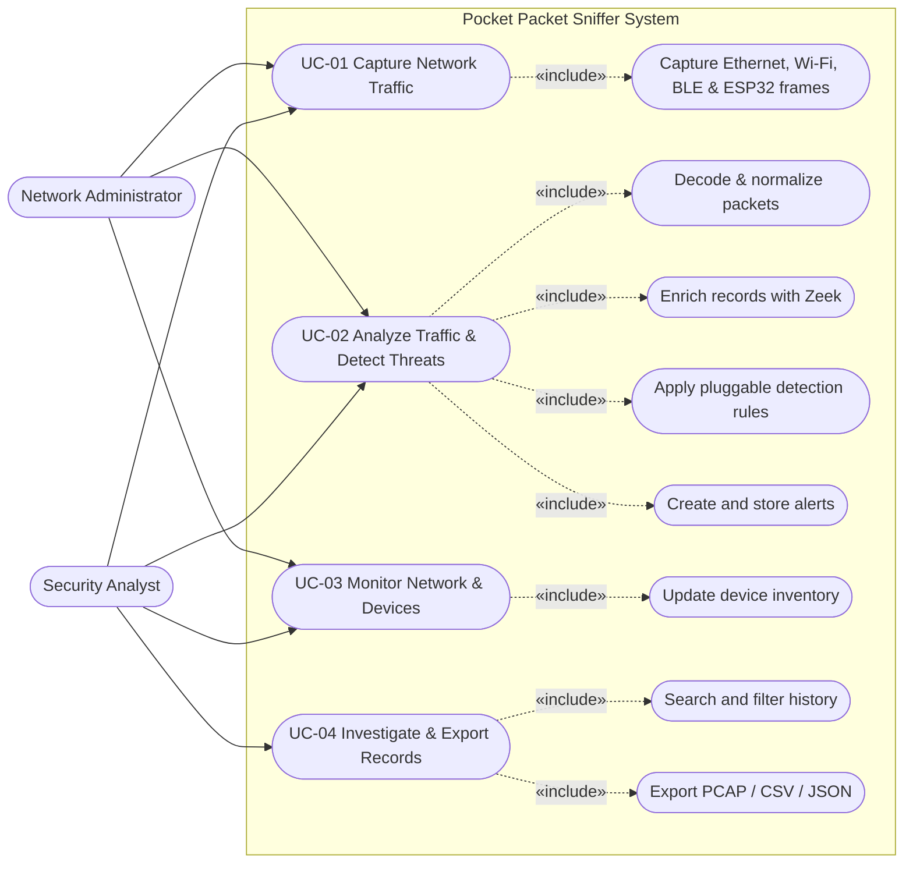

# Software Requirements Specification (SRS)
## Pocket Packet Sniffer
**Course:** Software Engineering (UE24CS341A)  
**Institution:** PES University, Department of Computer Science and Engineering  
**Version:** 1.0  
**Status:** Approved  
**Prepared by:** Ritu Ravish (Lead Consolidator), Vishal Prasath, Tejaswini R Pujar, Varshini A  
**Date:** October 2026  

---

## 1. Introduction

### 1.1 Purpose
This Software Requirements Specification (SRS) defines the complete software, hardware, and operational requirements for the **Pocket Packet Sniffer** (Version 1.0). The system is a compact, multi-interface network security appliance deployed on a Raspberry Pi with remote ESP32 sensor nodes. This document serves as the formal baseline for development, architecture design, and quality assurance verification across all four functional subsystems: Packet Capture (F1), Protocol Parsing & Zeek Integration (F2), Threat & Anomaly Detection (F3), and Live Monitoring & Reporting (F4).

### 1.2 Intended Audience
This document is prepared for:
* **Development Team:** To guide implementation across feature branches (`src/capture`, `src/parser`, `src/detection`, `src/dashboard`).
* **Quality Assurance Lead (Tejaswini R Pujar):** To validate requirement testability and construct the Software Test Plan (STP).
* **DevOps Lead (Vishal Prasath):** To configure CI/CD pipeline triggers, containerized builds, and deployment verification.
* **Scrum Master (Varshini A):** To verify requirements traceability across GitHub Project backlog issues and sprints.
* **Academic Evaluators & Instructors:** To review adherence to IEEE-830 standard requirements engineering principles.

### 1.3 Product Scope
The Pocket Packet Sniffer bridges the visibility gap between wired enterprise traffic and transient short-range wireless channels. The software captures packets across promiscuous Ethernet, monitor-mode WiFi (802.11 b/g/n), Bluetooth Low Energy (BLE), and remote ESP32 sniffer streams. It decodes multi-layer protocols, normalizes records into a single SQLite-backed data schema, ingests Zeek metadata, executes an extensible threat detection rule engine in real time, and serves an interactive web dashboard accessible via mobile and desktop browsers.

### 1.4 References
1. IEEE Std 830-1998: *Recommended Practice for Software Requirements Specifications*.
2. RFC 826: *An Ethernet Address Resolution Protocol (ARP)*.
3. RFC 791 / RFC 793 / RFC 768: *Internet Protocol (IPv4), Transmission Control Protocol (TCP), User Datagram Protocol (UDP)*.
4. IEEE 802.11-2020: *Wireless LAN Medium Access Control (MAC) and Physical Layer (PHY) Specifications*.
5. Bluetooth SIG: *Bluetooth Core Specification v4.2 / v5.0 (Low Energy)*.
6. Zeek Network Security Monitor Documentation (<https://docs.zeek.org>).
7. PES University: *Jackfruit Software Engineering Mini-Project Guidelines 2026*.

---

## 2. Overall Description

### 2.1 Product Perspective
The Pocket Packet Sniffer operates as an autonomous edge appliance. It acts as an embedded intrusion detection and packet analysis system running primarily on a Raspberry Pi 4 Model B running Linux (Raspberry Pi OS / Debian), augmented with ESP32 microcontrollers deployed as remote radio capture probes communicating over Wi-Fi/UDP.

```
       +-------------------------------------------------------+
       |                  Physical Network                     |
       |    [Ethernet LAN]      [802.11 WiFi]     [BLE Beacons]|
       +--------+--------------------+-------------------+-----+
                |                    |                   |
                v                    v                   v
       +-------------------------------------------------------+
       |   F1: Multi-Interface Capture (eth0, wlan0mon, hci0)  |
       |        + Remote ESP32 Sniffer Node Frame Ingestion    |
       +----------------------------+--------------------------+
                                    | Raw PCAP / Frame Streams
                                    v
       +-------------------------------------------------------+
       |   F2: Protocol Parsing, Normalization & Zeek Ingest   |
       |       Storage: SQLite (packets, conns, sessions)      |
       +-------------------+-----------------------------------+
                           | NormalizedRecord Stream
                           v
       +-------------------------------------------------------+
       |   F3: Threat & Anomaly Detection Engine (Rule-Based)  |
       |       Alert Pipeline (Severity, Evidence, Remediation)|
       +-------------------+-----------------------------------+
                           | Alert & Traffic Telemetry
                           v
       +-------------------------------------------------------+
       |   F4: Dashboard, REST/WebSocket API & Inventory       |
       |       (Live feeds, charts, PCAP/CSV/JSON export)      |
       +-------------------------------------------------------+
```

### 2.2 Product Functions
* **Promiscuous & Monitor Capture:** Raw packet ingestion across Ethernet (`eth0`), WiFi monitor mode (`wlan0mon`) with 2.4 GHz channel hopping, Bluetooth Low Energy (`hci0`), and ESP32 remote probes.
* **Protocol Decoding & Zeek Enriched Telemetry:** Multi-layer packet dissection (L2-L7) into a unified relational database and ingestion of Zeek connection logs.
* **Real-time Threat & Anomaly Detection:** Rule-based detection of ARP cache poisoning, TCP/UDP port scans, DNS anomalies, 802.11 Deauth floods, Rogue/Evil-Twin APs, and BLE advertisement floods.
* **Interactive Monitoring & Reporting:** Web-based GUI featuring real-time bandwidth metrics, protocol distributions, device inventory with MAC OUI fingerprinting, and session exports.

### 2.3 User Classes and Characteristics
* **Security Analyst / Pen-Tester:** Skilled user seeking anomalies, deauth attacks, rogue APs, and attack PCAP captures.
* **Network Administrator:** Monitors local subnet utilization, IP-MAC consistency, bandwidth hogs, and rogue wireless devices.
* **Academic Evaluator / Student:** Verifies software engineering rigor, test coverage, code architecture, and CI/CD automation.

### 2.4 Operating Environment
* **Hardware Appliance:** Raspberry Pi 4 Model B (4GB/8GB RAM), Quad-core ARM Cortex-A72 @ 1.5GHz.
* **Remote Probes:** NodeMCU ESP32-WROOM-32 microcontrollers configured with promiscuous sniffer firmware.
* **Operating System:** Linux (Debian 12 Bookworm / Raspberry Pi OS 64-bit).
* **Runtime Stack:** Python 3.11+, SQLite 3, Zeek 5.0+, Docker 24+, Systemd.
* **Client Browser:** Chromium, Mozilla Firefox, Safari (Mobile & Desktop).

### 2.5 Design and Implementation Constraints
* **Resource Bounds:** The entire pipeline must run smoothly within 4 GB RAM and moderate CPU limits of a Raspberry Pi 4 without packet drop during typical lab loads (up to 5,000 pkts/sec).
* **Linux Kernel Privileges:** Monitor mode and raw socket capture require Linux capabilities (`CAP_NET_RAW`, `CAP_NET_ADMIN`) or root privileges.
* **Modularity:** Modules must remain loosely coupled using clean interfaces and data contracts (`NormalizedRecord`, `Alert`).
* **Storage Constraint:** On-device SQLite database size must be bounded with automatic rotation to prevent SD card exhaustion.

### 2.6 Assumptions and Dependencies
* The host WiFi adapter supports monitor mode and packet injection (e.g., Atheros AR9271, RT3070, or onboard broadcom with nexmon).
* The Raspberry Pi has an active Bluetooth adapter (`hci0`) with bluez installed.
* Third-party tools (Zeek, Scapy, Bandit, SonarQube) remain compliant with open-source licensing.

---

## 3. External Interface Requirements

### 3.1 User Interfaces
* **Web UI Dashboard:** Responsive single-page web application served at `http://<pi-ip>:8000/`.
* **Live Feed Panel:** Table updating dynamically via WebSocket showing timestamp, interface, src/dst IP, protocol, length.
* **Alert Bell / Notification Bar:** Visual alert banner color-coded by severity (`CRITICAL`: Red, `HIGH`: Orange, `MEDIUM`: Yellow, `LOW`: Blue).
* **Device Inventory Table:** Lists detected devices, vendor (via MAC OUI lookup), first/last seen timestamps, and active channel/RSSI.
* **Export Controls:** Modal dialog permitting download of filtered sessions in PCAP, CSV, and JSON formats.

### 3.2 Software Interfaces
* **F1 -> F2:** Raw frame byte arrays and PCAP file handles passed from Capture engine to Parser workers.
* **F2 -> F3:** Ingestion of strongly-typed `NormalizedRecord` objects containing dissected network attributes.
* **F3 -> F4:** Publication of structured `Alert` objects dispatched to database and real-time WebSocket feeds.
* **F2/F4 -> SQLite Database:** Structured schema (`packets`, `connections`, `devices`, `alerts`) stored locally in SQLite.

### 3.3 Communication Interfaces
* **Internal Inter-Module IPC:** Python asyncio event loops, in-memory queues (`asyncio.Queue`), and SQLite WAL mode.
* **Client-Server Communication:** HTTP/1.1 REST endpoints and bidirectional WebSockets (`ws://<pi-ip>:8000/ws/live`).
* **Remote Probe Ingestion:** UDP socket listening on port `5555` ingesting ESP32 binary payload frames.

### 3.4 Hardware Interfaces
* **Ethernet PHY (`eth0`):** Promiscuous mode raw socket binding.
* **Wireless NIC (`wlan0` / `wlan1`):** `nl80211` driver interface managed via `iw` / `airmon-ng`.
* **Bluetooth HCI (`hci0`):** Linux BlueZ socket interface for BLE advertisement scanning.

---

## 4. Analysis Models

### 4.1 Use Case Diagram (System-Wide)



---

## 5. System Features

### 5.1 System Feature 1: Multi-Interface Packet Capture (Owner: Vishal Prasath)
#### 5.1.1 Description and Priority
* **Description:** Manages simultaneous packet capture across Ethernet in promiscuous mode, WiFi in monitor mode with 2.4 GHz channel hopping, BLE advertisements, and remote ESP32 sniffer probe streams, supporting session recording and PCAP rotation.
* **Priority:** High.

#### 5.1.2 Stimulus/Response Sequences
1. **Stimulus:** Operator starts an Ethernet capture session on interface `eth0`.
   * **Response:** System puts `eth0` in promiscuous mode, opens a raw socket, and streams captured frames to the parser.
2. **Stimulus:** WiFi monitor mode is initialized.
   * **Response:** System creates virtual monitor interface `wlan0mon` and initiates background channel hopping across channels 1 to 13 every 250ms.
3. **Stimulus:** A remote ESP32 sniffer transmits UDP packets to port 5555.
   * **Response:** Ingestion worker receives UDP datagrams, extracts payload headers, and feeds them into the unified capture buffer.

#### 5.1.3 Functional Requirements
* **REQ-F1-01 (Promiscuous Ethernet Capture):** The system shall capture all Ethernet frames on designated interfaces (`eth0`) regardless of destination MAC address.
* **REQ-F1-02 (WiFi Monitor Mode & Channel Hopping):** The system shall put supported wireless adapters into 802.11 monitor mode and hop across 2.4 GHz channels 1–13 at a configurable frequency (default 250ms).
* **REQ-F1-03 (Bluetooth Low Energy Capture):** The system shall capture Bluetooth Low Energy advertisement frames (`ADV_IND`, `ADV_NONCONN_IND`) using BlueZ HCI interfaces.
* **REQ-F1-04 (Remote ESP32 Ingestion):** The system shall listen on UDP port 5555 to ingest raw wireless frames forwarded by external ESP32 sniffer probes.
* **REQ-F1-05 (PCAP Session Management & Rotation):** The system shall save captured traffic into standard PCAP format files with automatic session rotation based on file size (default: 50MB) or time limit (default: 15 minutes).

---

### 5.2 System Feature 2: Protocol Parsing and Zeek Integration (Owner: Tejaswini R Pujar)
#### 5.2.1 Description and Priority
* **Description:** Decodes raw packets across Layer 2 through Layer 7, normalizes multi-interface data into a unified packet schema, ingests Zeek metadata logs, and manages persistence in SQLite.
* **Priority:** High.

#### 5.2.2 Stimulus/Response Sequences
1. **Stimulus:** Raw Ethernet frame arrives from F1.
   * **Response:** Parser decodes Ethernet header, IP header, and transport layer (TCP/UDP/ICMP), emitting a `NormalizedRecord` in under 1ms.
2. **Stimulus:** Zeek log daemon produces a `conn.log` entry.
   * **Response:** Zeek ingestion worker parses JSON/TSV connection record, enriching the corresponding connection table in SQLite.

#### 5.2.3 Functional Requirements
* **REQ-F2-01 (Multi-Layer Protocol Decoding):** The system shall decode Link, Network, Transport, and Application protocols including Ethernet, 802.11, ARP, IPv4, TCP, UDP, ICMP, and DNS.
* **REQ-F2-02 (Unified Packet Schema Normalization):** The system shall map disparate frame types (Ethernet, WiFi, BLE) into a unified `NormalizedRecord` data model.
* **REQ-F2-03 (Zeek Telemetry Integration):** The system shall run Zeek against live and recorded traffic and ingest generated Zeek logs (`conn.log`, `dns.log`) into the metadata store.
* **REQ-F2-04 (SQLite Storage Layer):** The system shall persist parsed packets, active connections, and session metadata into SQLite with indexed columns for IP, MAC, and timestamp.
* **REQ-F2-05 (Pluggable Parser Architecture):** The system shall provide an abstract protocol parser interface allowing new protocol dissectors to be added without modifying existing parser pipelines.

---

### 5.3 System Feature 3: Threat and Anomaly Detection with Alerting (Owner: Ritu Ravish)
#### 5.3.1 Description and Priority
* **Description:** An extensible, pluggable rule-based detection engine that continuously inspects the normalized packet stream across Ethernet, WiFi, and Bluetooth Low Energy interfaces to identify network cyberattacks, protocol anomalies, and rogue entities in real time.
* **Priority:** High.

#### 5.3.2 Stimulus/Response Sequences
1. **Stimulus:** F2 Parser streams a normalized ARP reply where the claimed IP is bound to a new, conflicting MAC address.
   * **Response:** Detection Engine flags an IP-MAC conflict, generates a `CRITICAL` severity `Alert` object with offending MAC addresses and timestamps, and emits it to the alert dispatch pipeline within 1 second.
2. **Stimulus:** A remote host sends SYN packets across 15 distinct destination ports within a 5-second sliding window.
   * **Response:** Detection Engine flags a horizontal/vertical port scan, generates a `HIGH` severity `Alert` containing the attacker IP, scanned port range, and packet counts.
3. **Stimulus:** A WiFi client receives bursts of 802.11 Deauthentication frames (subtype 0x000C) exceeding 15 frames per second.
   * **Response:** Detection Engine flags a WiFi Deauth Flood attack, generates a `CRITICAL` severity `Alert` detailing targeted BSSID, client MAC, and frame rate.
4. **Stimulus:** An unrecognized BLE peripheral transmits excessive advertisement packets (`ADV_IND`) exceeding rate thresholds.
   * **Response:** Detection Engine flags a BLE Advertisement Flood / DoS, generates a `MEDIUM` severity `Alert` with advertiser MAC and burst volume.

#### 5.3.3 Functional Requirements
* **REQ-F3-01 (ARP Spoofing / Cache Poisoning Detection):** The system shall maintain a dynamic IP-to-MAC baseline table and detect when an incoming ARP packet attempts to associate an existing IP with an unauthorized or conflicting MAC address.
* **REQ-F3-02 (ARP Reply Flood Detection):** The system shall monitor the rate of unsolicited/gratuitous ARP replies per MAC address and generate an alert if the count exceeds configurable threshold $N$ within sliding window $T$ seconds (default: 5 replies in 3s).
* **REQ-F3-03 (TCP/UDP Port Scan Detection):** The system shall track connection attempts from source IP addresses across multiple destination ports within a configurable sliding window and trigger an alert upon detecting horizontal sweeps or vertical port scans.
* **REQ-F3-04 (DNS Anomaly & Tunneling Detection):** The system shall analyze DNS query frequency, domain label length, entropy, and NXDOMAIN error ratios to detect DNS tunneling, domain generation algorithms (DGA), and high-volume DNS reconnaissance.
* **REQ-F3-05 (WiFi 802.11 Deauthentication Flood Detection):** The system shall monitor 802.11 management frames (subtypes 0x000C Deauth and 0x000A Disassoc) and trigger an alert if the frame rate directed at or broadcast by an AP exceeds the configurable flood threshold.
* **REQ-F3-06 (Rogue and Evil-Twin AP Detection):** The system shall inspect beacon and probe response frames to detect duplicate SSIDs operating with unexpected BSSIDs, differing channel configurations, or degraded encryption suites.
* **REQ-F3-07 (BLE Advertisement Flood & Spoofing Detection):** The system shall inspect Bluetooth Low Energy advertisement packets (`ADV_IND`, `ADV_NONCONN_IND`) to identify rapid MAC churning and high-rate advertising bursts indicating DoS or device spoofing.
* **REQ-F3-08 (Configurable Thresholds & Sliding Time Windows):** The system shall permit fine-tuning of rate thresholds, detection windows, whitelist IP/MAC entries, and rule activation states through a structured configuration file or API without recompilation.
* **REQ-F3-09 (Standardized Alert Generation and Evidence Packaging):** The system shall package every detected anomaly into a structured `Alert` schema including unique `alert_id`, epoch `timestamp`, `threat_type`, `severity` (`LOW`, `MEDIUM`, `HIGH`, `CRITICAL`), `evidence` dictionary, and `mitigation` guidance.
* **REQ-F3-10 (Pluggable Detection Rule Engine Architecture):** The system shall provide an extensible `BaseDetector` interface and `DetectionEngine` coordinator allowing detection rules to be dynamically registered, executed, and reset without modifying core pipeline code.

---

### 5.4 System Feature 4: Live Monitoring, Device Inventory and Reporting (Owner: Varshini A)
#### 5.4.1 Description and Priority
* **Description:** Delivers a real-time web monitoring interface, REST and WebSocket endpoints, automatic network device discovery with MAC OUI vendor resolution, multi-interface filtering, and forensic data export.
* **Priority:** High.

#### 5.4.2 Stimulus/Response Sequences
1. **Stimulus:** Client browser connects to WebSocket endpoint `ws://<pi-ip>:8000/ws/live`.
   * **Response:** Backend streams live bandwidth metrics, packet rates, and active alert events with sub-second latency.
2. **Stimulus:** New MAC address observed on the wire or wireless channel.
   * **Response:** Device inventory worker queries local IEEE OUI database, creates device entry with manufacturer name, and updates dashboard inventory view.
3. **Stimulus:** User applies filter `protocol=DNS` and clicks "Export to PCAP".
   * **Response:** Backend queries SQLite database, assembles matching packets, and streams a downloadable PCAP file.

#### 5.4.3 Functional Requirements
* **REQ-F4-01 (REST & WebSocket Backend API):** The system shall expose REST API endpoints for packets, alerts, and system health, alongside a WebSocket channel streaming live traffic statistics.
* **REQ-F4-02 (Live Web Dashboard & Visualization):** The system shall render a responsive web dashboard with a real-time packet stream table, active alert feed, and dynamic protocol distribution charts.
* **REQ-F4-03 (Device Inventory & MAC Fingerprinting):** The system shall identify unique network hosts, resolve manufacturer details via IEEE MAC OUI lookup, record BLE local names, and track first/last seen timestamps.
* **REQ-F4-04 (Multi-Interface Search, Filtering & History):** The system shall allow users to search and filter historical records by interface, protocol, IP, MAC address, and time range.
* **REQ-F4-05 (Session & Report Export):** The system shall allow users to export captured sessions and query results in PCAP, CSV, and JSON formats.

---

## 6. Non-Functional Requirements

### 6.1 Performance Requirements
* **NFR-PERF-01 (Lossless Capture):** The capture pipeline shall sustain up to 5,000 packets per second without packet drop on standard Raspberry Pi 4 hardware under typical lab traffic.
* **NFR-PERF-02 (Bounded Parser Queue):** Protocol parsing and normalization shall process incoming packets concurrently, ensuring queue memory depth remains under 10,000 records.
* **NFR-PERF-03 (Real-time Dashboard Latency):** Live metrics, packet feeds, and threat alerts shall appear on the client dashboard within 2.0 seconds of physical packet capture.

### 6.2 Security Requirements (Lead: Ritu Ravish)
* **SEC-01 (Static Application Security Testing):** All codebase modules shall be scanned via **Bandit** and **SonarQube**, maintaining zero high-severity or critical vulnerabilities before PR merge.
* **SEC-02 (Resilient & Safe Packet Ingestion):** The detection engine and parser shall enforce defensive exception handling; malformed, fuzzed, or truncated packets shall be safely logged without crashing the process.
* **SEC-03 (Dependency Vulnerability Governance):** All dependencies in `requirements.txt` shall be continuously scanned with `pip-audit`, ensuring no known critical CVEs.
* **SEC-04 (Alert Data Integrity):** Alert records and evidentiary attributes stored in SQLite shall be immutable and tamper-resistant once recorded.

### 6.3 Software Quality Attributes
* **NFR-USE-01 (Responsive Usability):** The web dashboard shall be fully responsive, rendering properly on both mobile browsers (viewport $\ge 375\text{px}$) and desktop screens ($\ge 1280\text{px}$).
* **NFR-PORT-01 (Portable Embedded Deployment):** The complete software stack shall be deployable via Docker and systemd on a Raspberry Pi running Linux, automatically starting on system boot.
* **NFR-QA-01 (Testability & Code Coverage):** The codebase shall achieve $\ge 85\%$ line and branch test coverage across all functional modules.

---

## 7. Other Requirements
* **Ethical & Legal Compliance:** The packet sniffer software shall display a prominent legal disclaimer upon initial startup advising users to operate promiscuous and monitor mode capture only on networks where they possess explicit administrative authorization.

---

## 8. Appendix

### Appendix A: Glossary
* **ARP:** Address Resolution Protocol (RFC 826)
* **BLE:** Bluetooth Low Energy (Bluetooth 4.0+)
* **BSSID:** Basic Service Set Identifier (MAC address of wireless AP)
* **Deauth Attack:** 802.11 Deauthentication frame injection to forcibly disconnect clients
* **MITM:** Man-In-The-Middle attack
* **OUI:** Organizationally Unique Identifier (First 3 bytes of MAC address)
* **PCAP:** Packet Capture format (libpcap)
* **RTM:** Requirements Traceability Matrix

### Appendix B: Field Layouts

#### Table B.1: NormalizedRecord Schema (F2 -> F3 / Storage)
| Field Name | Type | Description | Mandatory | Example |
| :--- | :--- | :--- | :--- | :--- |
| `timestamp` | Float | Epoch timestamp in seconds | Y | `1728087600.125` |
| `interface` | String | Capturing interface name | Y | `eth0`, `wlan0mon`, `hci0` |
| `link_type` | String | Link layer type | Y | `ETHERNET`, `WIFI`, `BLE` |
| `src_mac` | String | Source MAC address | N | `00:11:22:33:44:55` |
| `dst_mac` | String | Destination MAC address | N | `ff:ff:ff:ff:ff:ff` |
| `src_ip` | String | Source IPv4 address | N | `192.168.1.50` |
| `dst_ip` | String | Destination IPv4 address | N | `192.168.1.1` |
| `protocol` | String | Transport / application protocol | N | `TCP`, `UDP`, `ARP`, `DNS` |
| `src_port` | Integer | Source port number | N | `54321` |
| `dst_port` | Integer | Destination port number | N | `80` |
| `payload_len` | Integer | Length of payload in bytes | Y | `1460` |
| `metadata` | Dict/JSON | Protocol-specific attributes | N | `{"arp_op": 2, "wifi_subtype": 12}` |

#### Table B.2: Alert Schema (F3 -> F4 / Storage)
| Field Name | Type | Description | Mandatory | Example |
| :--- | :--- | :--- | :--- | :--- |
| `alert_id` | String | Unique UUIDv4 identifier | Y | `c3a7e4b2-8f1d-4e92-a16f-123456789abc` |
| `timestamp` | Float | Epoch timestamp in seconds | Y | `1728087600.125` |
| `threat_type` | Enum | Classification of threat | Y | `ARP_SPOOFING` |
| `severity` | Enum | Risk severity (`LOW`, `MED`, `HIGH`, `CRIT`) | Y | `CRITICAL` |
| `title` | String | Human readable summary | Y | `ARP Cache Poisoning Detected` |
| `description` | String | Detailed anomaly explanation | Y | `Host claiming IP with conflicting MAC` |
| `source_interface` | String | Interface observing attack | Y | `eth0` |
| `evidence` | JSON | Forensic key-value dictionary | Y | `{"claimed_ip": "192.168.1.1", ...}` |
| `mitigation` | String | Recommended defensive step | Y | `Enable Dynamic ARP Inspection (DAI)` |

---

### Appendix C: Requirements Traceability Matrix (RTM)

| Sl. | Requirement ID | Requirement Description | Subsystem | Owner | Code File Reference | Unit Test ID | System Test ID |
| :---: | :--- | :--- | :--- | :--- | :--- | :--- | :--- |
| 1 | **REQ-F1-01** | Promiscuous Ethernet Capture | Capture | Vishal | `src/capture/ethernet.py` | `UT_F1_01` | `ST_F1_01` |
| 2 | **REQ-F1-02** | WiFi Monitor Mode & Hopping | Capture | Vishal | `src/capture/wifi.py` | `UT_F1_02` | `ST_F1_02` |
| 3 | **REQ-F1-03** | BLE Advertisement Capture | Capture | Vishal | `src/capture/ble.py` | `UT_F1_03` | `ST_F1_03` |
| 4 | **REQ-F1-04** | Remote ESP32 Frame Ingest | Capture | Vishal | `src/capture/esp32.py` | `UT_F1_04` | `ST_F1_04` |
| 5 | **REQ-F1-05** | PCAP Session Recording & Rotation | Capture | Vishal | `src/capture/session.py` | `UT_F1_05` | `ST_F1_05` |
| 6 | **REQ-F2-01** | Multi-Layer Protocol Decoding | Parser | Tejaswini | `src/parser/dissector.py` | `UT_F2_01` | `ST_F2_01` |
| 7 | **REQ-F2-02** | Unified Schema Normalization | Parser | Tejaswini | `src/parser/normalizer.py` | `UT_F2_02` | `ST_F2_01` |
| 8 | **REQ-F2-03** | Zeek Telemetry Ingestion | Parser | Tejaswini | `src/parser/zeek_ingest.py` | `UT_F2_03` | `ST_F2_02` |
| 9 | **REQ-F2-04** | SQLite Database Storage Layer | Parser | Tejaswini | `src/parser/storage.py` | `UT_F2_04` | `ST_F2_03` |
| 10 | **REQ-F2-05** | Pluggable Parser Interface | Parser | Tejaswini | `src/parser/base.py` | `UT_F2_05` | `ST_F2_03` |
| 11 | **REQ-F3-01** | ARP Cache Poisoning Detection | Detection | Ritu | `src/detection/rules/arp_spoof.py` | `UT_F3_01, UT_F3_02` | `ST_F3_01` |
| 12 | **REQ-F3-02** | ARP Reply Flood Detection | Detection | Ritu | `src/detection/rules/arp_spoof.py` | `UT_F3_03` | `ST_F3_01` |
| 13 | **REQ-F3-03** | TCP/UDP Port Scan Detection | Detection | Ritu | `src/detection/rules/port_scan.py` | `UT_F3_07` | `ST_F3_02` |
| 14 | **REQ-F3-04** | DNS Anomaly & Tunneling | Detection | Ritu | `src/detection/rules/dns_anomaly.py` | `UT_F3_08` | `ST_F3_03` |
| 15 | **REQ-F3-05** | WiFi 802.11 Deauth Flood | Detection | Ritu | `src/detection/rules/wifi_deauth.py` | `UT_F3_09` | `ST_F3_04` |
| 16 | **REQ-F3-06** | Rogue & Evil-Twin AP | Detection | Ritu | `src/detection/rules/rogue_ap.py` | `UT_F3_10` | `ST_F3_05` |
| 17 | **REQ-F3-07** | BLE Flood & Spoofing | Detection | Ritu | `src/detection/rules/ble_flood.py` | `UT_F3_11` | `ST_F3_06` |
| 18 | **REQ-F3-08** | Configurable Dynamic Thresholds | Detection | Ritu | `src/detection/config.py` | `UT_F3_12` | `ST_F3_07` |
| 19 | **REQ-F3-09** | Standardized Alert Schema | Detection | Ritu | `src/detection/models.py` | `UT_F3_05` | `ST_F3_08` |
| 20 | **REQ-F3-10** | Pluggable Rule Engine Core | Detection | Ritu | `src/detection/engine.py` | `UT_F3_05, UT_F3_06` | `ST_F3_09` |
| 21 | **REQ-F4-01** | REST & WebSocket Backend API | Dashboard | Varshini | `src/dashboard/api.py` | `UT_F4_01` | `ST_F4_01` |
| 22 | **REQ-F4-02** | Live Web Dashboard & Visuals | Dashboard | Varshini | `src/dashboard/frontend/` | `UT_F4_02` | `ST_F4_01` |
| 23 | **REQ-F4-03** | Device Inventory & MAC Lookup | Dashboard | Varshini | `src/dashboard/inventory.py` | `UT_F4_03` | `ST_F4_02` |
| 24 | **REQ-F4-04** | Search, Filtering & History | Dashboard | Varshini | `src/dashboard/history.py` | `UT_F4_04` | `ST_F4_03` |
| 25 | **REQ-F4-05** | Session Export (PCAP/CSV/JSON) | Dashboard | Varshini | `src/dashboard/export.py` | `UT_F4_05` | `ST_F4_04` |
| 26 | **SEC-01** | Bandit & SonarQube SAST | Security | Ritu | `.bandit`, `sonar-project.properties`| - | `ST_SEC_01` |
| 27 | **SEC-02** | Resilient Packet Processing | Security | Ritu | `src/detection/engine.py` | `UT_F3_04` | `ST_SEC_02` |
| 28 | **NFR-PERF-01** | Lossless Capture at Lab Rates | Quality | Vishal | `src/capture/` | `UT_F1_01` | `ST_PERF_01`|
| 29 | **NFR-PORT-01** | Raspberry Pi Docker & systemd | DevOps | Vishal | `Dockerfile`, `docker-compose.yml` | - | `ST_DEPLOY_01`|
| 30 | **NFR-USE-01** | Phone-Friendly Mobile Layout | Frontend | Varshini | `src/dashboard/frontend/` | `UT_F4_02` | `ST_USE_01` |
